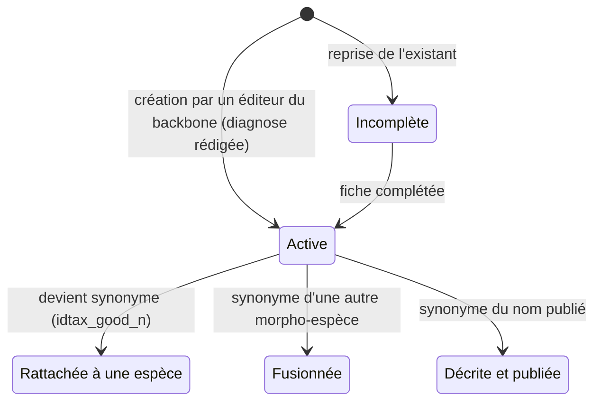

# Morpho-espèces dans cafriplotsR — note de concept

Gilles Dauby · 2026-10-07 · note de conception (compagnon : [note d'implémentation](design_note_morpho_species_implementation.md))

## Contexte et objectifs

Une morpho-espèce devient dans cafriplotsR un taxon à part entière : nommé, daté, attribué à des auteurs et décrit par une diagnose en texte libre, complétée si possible par une liste fermée de critères morphologiques. Ses spécimens sont ceux qui sont identifiés sous son nom. Aujourd'hui, `table_taxa` ne porte qu'un flag `morpho_species` (oui/non) : on sait qu'un nom est une morpho-espèce, mais pas ce qu'il recouvre.

Sans fiche descriptive, une morpho-espèce n'est interprétable que par la personne qui l'a créée. Elle ne peut être ni comparée d'un site à l'autre, ni transmise à un taxonomiste, ni résolue proprement quand une identification arrive. Baker et al. (2017) pointent exactement ce problème pour les réseaux de parcelles tropicales : les concepts de morpho-espèces sont rarement standardisés entre chercheurs et entre sites.

Objectifs :

- Répondre pour chaque morpho-espèce à six questions : qui l'a nommée, où, quand, pourquoi, avec quels caractères et, point à décider, sur la base de quels spécimens (la description d'une morpho-espèce doit-elle citer des spécimens, ou ses spécimens sont-ils seulement ceux identifiés sous son nom ?).
- Permettre de comparer des morpho-espèces entre elles et avec des espèces décrites, puis de les résoudre (rattachement, fusion, description).
- Faire évoluer l'appli Shiny de gestion du backbone pour la création, la consultation, la comparaison et la résolution.

## Ce qui existe ailleurs

Aucun réseau tropical ne propose un modèle complet « nom + auteurs + spécimen + diagnose structurée » ; les briques existent séparément et peuvent être combinées. Le modèle le plus abouti pour le nommage est celui des *phrase names* australiens ; pour la description structurée, c'est le format de données descriptives SDD / Xper3.

| Initiative | Ce qu'elle fait | À reprendre dans cafriplotsR |
| --- | --- | --- |
| [Phrase names australiens](https://en.wikipedia.org/wiki/Phrase_name) (Australian Herbarium Information Systems Committee, 1992) | Nom informel à 4 éléments : genre + « sp. » + localité ou trait + (collecteur numéro). Ex. *Derris* sp. Wenlock River (B.Hyland 21082V). Devient synonyme quand le taxon est décrit. | Le principe d'un nom autoporteur et unique. Ici, l'unicité vient du couple numéro + auteur plutôt que d'un libellé et d'un numéro de collecte. |
| Flores régionales africaines (Flora of Tropical East Africa, Flore du Gabon…) | Taxons non décrits notés « sp. A », « sp. B », avec description courte et spécimens cités. | La diagnose différentielle (« diffère de X par… ») et la liste des spécimens cités. |
| [ATDN tree morphospecies website](https://atdnmorphospecies.myspecies.info/node/7499) (Amazon Tree Diversity Network) | Plateforme collaborative pour standardiser les morpho-espèces d'arbres amazoniens entre inventaires ; noms du type « sp. PlotA#1 ». Exige au minimum une image scannée de l'exsiccatum. | L'objectif de comparaison entre sites. L'exigence d'image n'est pas reprise : la base ne gère pas d'images. |
| [ForestPlots.net](https://forestplots.net/upload/fr/VoucherImport_FR.pdf) (RAINFOR, AfriTRON…) | Chaque voucher est lié à un arbre marqué de la parcelle ; code voucher, collecteur et herbier sont validés à l'import. | Déjà en place dans cafriplotsR : lien spécimen ↔ individu de parcelle et contrôle collecteur / herbier (app Shiny, data\_link\_specimens). Les spécimens d'une morpho-espèce sont ceux identifiés sous son nom, retrouvés par ce lien existant. |
| [Open Nomenclature](https://doi.org/10.1111/2041-210X.12594) (Sigovini et al. 2016) ; [Horton et al. 2021](https://www.frontiersin.org/journals/marine-science/articles/10.3389/fmars.2021.620702/pdf) | Recommandations pour l'usage des qualificatifs (sp., cf., aff., sp. nov., indet.) et pour distinguer incertitude d'identification et taxon non décrit. | Un champ « qualificatif » normalisé et la distinction « morpho-espèce » vs « identification incertaine ». |
| [Xper3](https://europeanjournaloftaxonomy.eu/index.php/ejt/article/view/2875) (Kerner et al. 2025) / standard [SDD](https://sdd.tdwg.org/2006/Schema/1.1/documentation/SDD_TypeLib_Overview.html) du TDWG | Données descriptives : caractères × états × taxons, clés d'identification multi-accès. | La structure des critères (caractère catégoriel à états définis, ou numérique avec unité) ; un export éventuel vers Xper3. |

Deux résultats cadrent l'enjeu. [Baker et al. (2017)](https://donoghuelab.yale.edu/sites/default/files/baker_tree_2017.pdf) recommandent de déposer les vouchers de parcelles en herbier et de les rendre disponibles en images liées aux enregistrements de parcelles, pour permettre la comparaison à l'écran. [Pos et al. (2014)](https://pmc.ncbi.nlm.nih.gov/articles/PMC4278815) montrent qu'écarter les taxons non identifiés change peu la diversité alpha et la composition (R² > 0,95 sur 202 parcelles d'1 ha) : la valeur des morpho-espèces se joue donc surtout dans le turnover entre sites et la résolution taxonomique à long terme, ce qui exige leur cohérence entre sites.

## Concept proposé

Une morpho-espèce reste une ligne de `table_taxa` (`morpho_species = TRUE`) rattachée à un genre, ou à défaut à une famille, et reçoit en plus une **fiche** et, facultativement, une **description morphologique**. Aucun spécimen n'est exigé à la création : souvent, la morpho-espèce est créée d'abord, puis des spécimens sont identifiés sous ce nom. Il n'y a pas de spécimen de référence unique : ce sont les spécimens identifiés sous la morpho-espèce qui la documentent.

### La fiche : six questions

| Question | Contenu de la fiche | Obligatoire |
| --- | --- | --- |
| Quoi | Nom (genre + sp + numéro + auteur), code stable, taxon parent (genre ou famille), qualificatif facultatif (aff. avec son espèce de référence, ou sp. nov.), statut | Oui (sauf le qualificatif) |
| Qui | Auteur(s) de la morpho-espèce, pris dans la liste des collecteurs/personnes existante ; le premier auteur porte la numérotation ; utilisateur qui l'a saisie (enregistré automatiquement) | Oui (auteurs) |
| Où | Rien à saisir : la répartition se déduit des spécimens et des individus de parcelles identifiés sous ce nom | — |
| Quand | Année du nom (par défaut l'année de création dans la base, modifiable si la description est antérieure à la saisie) ; date de création dans la base, dates de révision | Oui (automatique) |
| Pourquoi | Diagnose en texte libre ; motif : matériel stérile non identifiable, spécimen fertile ne correspondant à aucune espèce connue, espèce potentiellement nouvelle, complexe taxonomique non résolu ; espèces proches comparées (pour une aff., la diagnose est différentielle : « diffère de *X* par… ») | Oui (diagnose) ; motif et espèces comparées facultatifs |
| Sur quelle base | Spécimens et individus de parcelles identifiés sous ce nom | Rien à saisir ; à décider : la description doit-elle citer des spécimens ? |

Les critères morphologiques (section suivante) complètent la fiche ; ils sont facultatifs. Chaque valeur peut indiquer sa source (spécimen d'herbier, observation de terrain, littérature). Les mêmes critères peuvent aussi décrire une espèce nommée, ce qui rend la comparaison directe.

### Qualificatifs

Toute morpho-espèce porte un nom de la forme *Genre* spN Auteur (voir Convention de nom). Le qualificatif est **facultatif** : il précise ce qu'on sait de plus sur le taxon. Deux valeurs : **aff.** et **sp. nov.** Le cas le plus fréquent reste la morpho-espèce sans qualificatif.

| Qualificatif | Sens | Espèce de référence | Description attendue |
| --- | --- | --- | --- |
| aucun | Morpho-espèce rattachée au genre, sans hypothèse sur une espèce proche | Aucune | Diagnose : ce qui la distingue des autres espèces du genre (décrites et morpho-espèces) ; critères facultatifs |
| aff. | Proche d'une espèce connue du même genre, mais distincte (ex. *Diospyros* sp1 Dauby aff. *iturensis*) | Obligatoire, choisie dans le backbone ; une ou deux espèces proches supplémentaires possibles | Diagnose différentielle : ce qui la distingue de l'espèce de référence (feuilles plus grandes, indument présent…) |
| sp. nov. | Espèce considérée comme nouvelle, potentielle ou certaine ; d'abord sans nom latin, puis éventuellement avec un nom latin choisi, en attente de publication | Facultative (espèce la plus proche, utile pour la diagnose) | Diagnose ; critères facultatifs, utiles pour préparer la future description |

Le qualificatif peut être ajouté, changé ou retiré sans changer d'identifiant ni de nom : *Diospyros* sp1 Dauby peut devenir aff. *iturensis*, puis sp. nov. Quand un nom latin est choisi pour une sp. nov., il remplace « sp1 » (l'ancien nom reste consultable). À la publication, la morpho-espèce n'est pas modifiée : le nom publié entre dans le backbone comme une nouvelle entrée, et la morpho-espèce en devient synonyme (`idtax_good_n`). Par exemple, *Tessmannia* 'microphylla' sp. nov. est devenue synonyme de *Tessmannia microphylla* ; les deux entrées restent dans le backbone. De même, une morpho-espèce peut se révéler être une espèce déjà décrite : elle devient alors synonyme de ce nom. Une sp. nov., avec ou sans nom latin, ne sort jamais de la base comme un nom valide.

**cf.** est traité à part : il qualifie une identification (« cet individu ou ce spécimen est probablement *X*, à confirmer »), pas un taxon. Il est donc porté par la détermination d'un individu de parcelle ou d'un spécimen, et pointe vers un taxon existant, qui peut lui-même être une morpho-espèce. Il ne crée pas de ligne dans le backbone.

### Convention de nom

Le nom d'une morpho-espèce a toujours la même forme : genre, « sp » suivi d'un numéro, puis le ou les auteurs, par exemple *Diospyros* sp1 Dauby et *Diospyros* sp1 Lachenaud. La numérotation est séquentielle et propre à chaque auteur dans un genre : le premier auteur porte la série, et un numéro n'est jamais réattribué, même après résolution de la morpho-espèce. Deux auteurs peuvent donc avoir chacun leur *Diospyros* sp1 : c'est le couple numéro + auteur qui rend le nom unique, pas un libellé géographique ou descriptif.

Le qualificatif s'affiche à la suite : *Diospyros* sp1 Dauby aff. *iturensis*, *Diospyros* sp2 Dauby sp. nov. L'année du nom figure dans la fiche ; par défaut c'est l'année de création dans la base, modifiable quand la morpho-espèce a été décrite avant d'être saisie. Un code court stable (ex. `MS-0001`) accompagne le nom et ne change jamais, même si la morpho-espèce change de genre et reçoit un nouveau numéro.

### Règles de gestion

- Une morpho-espèce n'est jamais supprimée : elle est résolue. Sa résolution passe par le mécanisme de synonymie déjà en place (`idtax_good_n`), donc les individus de parcelles suivent sans retraitement.
- Elle a une portée globale à la base, pas à une parcelle : avant d'en créer une, on cherche si une morpho-espèce existante du même genre correspond.
- Seuls les utilisateurs autorisés à modifier le backbone créent des morpho-espèces, et une morpho-espèce n'est enregistrée que si sa diagnose est rédigée (et, pour une aff., son espèce de référence choisie). La caractérisation morphologique par les critères est facultative.
- Toute modification de la fiche ou des critères est historisée (qui, quand, quoi).

*Cycle de vie d'une morpho-espèce : elle n'est jamais supprimée, elle est résolue.*

Dans les trois résolutions, l'identifiant de la morpho-espèce est conservé et pointe vers le nom retenu : les spécimens et individus de parcelles identifiés sous la morpho-espèce suivent.

## Liste des critères morphologiques

La liste compte 52 critères, tous facultatifs : seule la diagnose en texte libre est exigée pour enregistrer une morpho-espèce. Les 19 critères de priorité 1 sont ceux à renseigner en premier quand on décrit. La liste privilégie les caractères végétatifs observables sur un arbre stérile et sur un spécimen d'herbier, dans la tradition des guides d'identification végétative (Letouzey, Tailfer, Hawthorne & Jongkind, Keller, Gentry). Les termes de nervation suivent le *Manual of Leaf Architecture* (Ellis et al. 2009) et ceux d'écorce Junikka (1994).

Types : **cat** = catégoriel à états définis (plusieurs états possibles si polymorphe) ; **num** = numérique, saisi en min–max ; **bool** = présence/absence ; **texte** = libre court. Priorité : 1 = à renseigner en premier, 2 = recommandé, 3 = si disponible.

**Deux modes de description.** Quand on renseigne des critères pour une morpho-espèce sans qualificatif ou sp. nov., ils le sont en valeur absolue. Pour une aff., la description est différentielle : on ne renseigne que les critères qui la distinguent de l'espèce de référence, chacun avec sa valeur et le sens de la différence ; tout critère non renseigné est réputé « comme l'espèce de référence ». Dans les deux cas, c'est la diagnose rédigée qui est obligatoire, pas les critères. Les critères de l'espèce de référence, s'ils sont renseignés dans la base, s'affichent à côté pour comparaison.

Exemple fictif de description différentielle :

| Critère | *Genre iturensis* (référence) | *Genre* aff. *iturensis* | Différence |
| --- | --- | --- | --- |
| Longueur du limbe | 8–14 cm | 18–25 cm | plus grande |
| Indument, face inférieure | glabre | poils étoilés denses | présent au lieu d'absent |
| Nombre de paires de nervures secondaires | 6–8 | 10–13 | plus nombreuses |

Diagnose correspondante : « diffère de *G. iturensis* par ses limbes plus grands (18–25 vs 8–14 cm), pubescents dessous, à 10–13 paires de nervures secondaires ».

**Liste des critères :**

| Organe | Critère | Type | États ou unité | Priorité |
| --- | --- | --- | --- | --- |
| Port et fût | Base du fût | cat | sans contreforts ; contreforts courts (< 1 m) ; contreforts hauts ; contreforts ailés ; racines-échasses ; fût cannelé | 1 |
| Port et fût | Épines ou aiguillons sur le fût | bool | — | 2 |
| Écorce externe | Aspect | cat | lisse ; finement fissurée ; profondément fissurée ; écailleuse (plaques) ; desquamante en lanières ; rugueuse | 1 |
| Écorce externe | Couleur | cat | blanchâtre ; gris ; brun ; rougeâtre ; verdâtre ; noirâtre | 2 |
| Écorce externe | Lenticelles | cat | absentes ; éparses ; abondantes ; en lignes horizontales | 2 |
| Tranche | Couleur de l'écorce interne | cat | blanc/crème ; jaune ; orange ; rose ; rouge ; brun | 1 |
| Tranche | Changement de couleur à l'air | texte | ex. « rose devenant brun en 1 min » | 2 |
| Tranche | Texture | cat | granuleuse ; fibreuse ; feuilletée ; marbrée/striée ; homogène | 1 |
| Tranche | Épaisseur de l'écorce | num | mm | 3 |
| Tranche | Odeur | cat | nulle ; aromatique ; résineuse ; aillée ; désagréable ; autre (préciser) | 1 |
| Tranche | Couleur de l'aubier | cat | blanc/crème ; jaune ; rose ; brun | 3 |
| Exsudat | Présence | bool | sur tranche, pétiole ou feuille cassée | 1 |
| Exsudat | Nature | cat | latex ; résine ; gomme ; sève aqueuse | 1 |
| Exsudat | Couleur | cat | blanc ; jaune ; orange ; rouge ; translucide | 1 |
| Exsudat | Abondance et évolution | texte | ex. « abondant, collant, noircit à l'air » | 2 |
| Rameaux | Section des jeunes rameaux | cat | cylindrique ; anguleuse ; quadrangulaire ; aplatie | 2 |
| Rameaux | Moelle fistuleuse ou domaties caulinaires (fourmis) | bool | — | 2 |
| Rameaux | Épines axillaires ou rameaux épineux | bool | — | 2 |
| Stipules | Présence | cat | absentes ; présentes ; cicatrice seule (annulaire ou latérale) | 1 |
| Stipules | Type | cat | libres latérales ; interpétiolaires ; intrapétiolaires ; soudées en gaine ; terminale enveloppant le bourgeon | 2 |
| Stipules | Persistance | cat | caduques ; persistantes | 2 |
| Feuille | Phyllotaxie | cat | alterne spiralée ; alterne distique ; opposée ; verticillée | 1 |
| Feuille | Type de feuille | cat | simple ; unifoliolée ; trifoliolée ; digitée ; paripennée ; imparipennée ; bipennée | 1 |
| Feuille | Nombre de folioles ou paires de folioles | num | nombre | 1 |
| Feuille | Disposition des folioles | cat | opposées ; alternées ; subopposées | 2 |
| Feuille | Rachis ailé | bool | — | 3 |
| Pétiole | Longueur | num | mm | 2 |
| Pétiole | Pulvinus | cat | absent ; basal ; apical ; basal et apical | 1 |
| Pétiole | Forme | cat | cylindrique ; canaliculé ; ailé ; renflé | 3 |
| Limbe | Longueur | num | cm | 1 |
| Limbe | Largeur | num | cm | 2 |
| Limbe | Forme | cat | elliptique ; oblongue ; ovale ; obovale ; lancéolée ; oblancéolée ; orbiculaire ; linéaire | 2 |
| Limbe | Base | cat | cunéiforme ; arrondie ; tronquée ; cordée ; décurrente ; asymétrique | 2 |
| Limbe | Apex | cat | acuminé ; aigu ; obtus ; arrondi ; émarginé ; mucroné | 2 |
| Limbe | Longueur de l'acumen | num | mm | 3 |
| Limbe | Marge | cat | entière ; dentée ; serrulée ; crénelée ; ondulée ; révolutée | 1 |
| Limbe | Consistance | cat | membraneuse ; papyracée ; subcoriace ; coriace ; charnue | 2 |
| Limbe | Discolore (faces de couleurs nettement différentes) | bool | — | 2 |
| Nervation | Nervation principale | cat | pennée ; triplinervée ; palmée (≥ 3 nervures basales) ; parallèle | 1 |
| Nervation | Nombre de paires de nervures secondaires | num | nombre | 1 |
| Nervation | Trajet des secondaires | cat | brochidodrome ; eucamptodrome ; craspédodrome ; avec nervure intramarginale | 2 |
| Nervation | Nervation tertiaire | cat | scalariforme (parallèle) ; réticulée ; peu visible | 2 |
| Nervation | Nervure médiane face supérieure | cat | saillante ; plane ; enfoncée | 2 |
| Indument | Présence par organe | cat | glabre ; poils sur rameaux ; sur pétiole ; sur face inférieure ; sur face supérieure | 1 |
| Indument | Type de poils | cat | simples ; étoilés ; écailles (lépidote) ; glanduleux ; en T (malpighiacés) | 2 |
| Indument | Couleur et densité | texte | ex. « tomentum roux dense » | 3 |
| Glandes et structures | Ponctuations translucides (vues par transparence) | bool | — | 1 |
| Glandes et structures | Glandes | cat | absentes ; sur pétiole ; à la base du limbe ; sur la marge ; sur la face inférieure | 2 |
| Glandes et structures | Domaties | cat | absentes ; en touffe de poils ; en pochette ; en fosse | 2 |
| Glandes et structures | Odeur de la feuille froissée | texte | — | 3 |
| Fertile | Position de l'inflorescence | cat | axillaire ; terminale ; caulinaire/raméeale | 3 |
| Fertile | Type de fruit, taille, couleur à maturité | cat + num | baie ; drupe ; capsule ; gousse ; samare ; syncarpe ; follicule — cm | 3 |

Les caractères fertiles restent volontairement sommaires : quand on dispose de fleurs et de fruits, une morpho-espèce a vocation à être identifiée ou décrite plutôt que décrite plus finement ici. La liste est extensible par famille (ex. glandes extraflorales chez les *Fabaceae*, ponctuations chez les *Myrtaceae*) sans modifier le modèle.

## Évolutions de l'appli Shiny backbone

L'appli gagne cinq fonctions autour des morpho-espèces ; les modules actuels d'ajout, de recherche et de mise à jour des taxons restent le point d'entrée.

1. **Créer** — un assistant en étapes : taxon parent ; qualificatif facultatif (aff. avec son espèce de référence, ou sp. nov.) ; dès le genre choisi, affichage des morpho-espèces existantes de ce genre (nom, auteurs, année, qualificatif, statut, nombre de spécimens et d'individus identifiés), avec accès à leur fiche et à la comparaison, pour éviter les doublons ; nom attribué automatiquement (numéro suivant dans la série du premier auteur pour ce genre) ; auteurs ; motif et espèces comparées ; diagnose ; puis saisie facultative des critères, en mode différentiel pour une aff. (grille pré-remplie avec les valeurs de l'espèce de référence, on ne modifie que ce qui diffère). L'enregistrement est bloqué tant que la diagnose n'est pas rédigée (et, pour une aff., tant que l'espèce de référence n'est pas choisie).
2. **Consulter** — une fiche lisible : en-tête (nom, auteurs, date, statut), diagnose, critères groupés par organe, spécimens, individus de parcelles rattachés avec leur carte.
3. **Comparer** — deux à quatre taxons côte à côte (morpho-espèces ou espèces nommées), critère par critère, différences mises en évidence. Variante : saisir quelques critères observés sur un arbre et obtenir les morpho-espèces compatibles du genre, comme une petite clé multi-accès.
4. **Résoudre** — un utilisateur autorisé à modifier le backbone rattache la morpho-espèce à une espèce, la fusionne avec une autre ou, une fois l'espèce décrite, la rattache au nom publié, avec une note justificative. Les droits sont ceux du backbone.
5. **Exporter** — une fiche HTML/PDF à envoyer à un herbier ou à un taxonomiste, et la liste des morpho-espèces d'un jeu de données avec leurs critères (tableur ; export vers Xper3 en option).

## Questions ouvertes

- [ ] Numérotation : série portée par le premier auteur seul, ou par la combinaison d'auteurs ? Faut-il renuméroter les morpho-espèces existantes (sp1 de terrain, codes OpenForis) dans la série de leur auteur ?
- [ ] Spécimens cités : la description d'une morpho-espèce doit-elle citer des spécimens (et, si oui, exiger un dépôt en herbier ?), ou ses spécimens sont-ils seulement ceux identifiés sous son nom ?
- [ ] Reprise de l'existant : comment organiser, famille par famille, la complétion des fiches des morpho-espèces déjà dans la base (environ 500 noms dans le cache du référentiel, dont environ 330 traitables par script et 120 à revoir par des experts ; voir la note d'implémentation) ?
- [ ] Critères numériques : saisie min–max sur le taxon seulement, ou aussi des mesures par spécimen dont on déduit min–max ?
- [ ] Morpho-genres (« *Fabaceae* sp. » non rattachable à un genre) : même mécanisme ?

## Documents de référence

Nomenclature informelle et morpho-espèces

- Sigovini M., Keppel E., Tagliapietra D. (2016). [Open Nomenclature in the biodiversity era](https://doi.org/10.1111/2041-210X.12594). *Methods in Ecology and Evolution* 7(10): 1217–1225.
- Horton T. et al. (2021). [Recommendations for the standardisation of open taxonomic nomenclature for image-based identifications](https://www.frontiersin.org/journals/marine-science/articles/10.3389/fmars.2021.620702/pdf). *Frontiers in Marine Science* 8: 620702.
- [Phrase name](https://en.wikipedia.org/wiki/Phrase_name) — convention australienne des noms informels (Australian Herbarium Information Systems Committee, 1992).
- [ATDN tree morphospecies website](https://atdnmorphospecies.myspecies.info/node/7499) — standardisation des morpho-espèces d'arbres amazoniens.
- Baker T.R. et al. (2017). [Maximising synergy among tropical plant systematists, ecologists, and evolutionary biologists](https://donoghuelab.yale.edu/sites/default/files/baker_tree_2017.pdf). *Trends in Ecology & Evolution* 32(4): 258–267.
- Pos E. et al. (2014). [Are all species necessary to reveal ecologically important patterns?](https://pmc.ncbi.nlm.nih.gov/articles/PMC4278815) *Ecology and Evolution* 4(24).
- ForestPlots.net. [Import des vouchers](https://forestplots.net/upload/fr/VoucherImport_FR.pdf).

Caractères morphologiques et terminologie

- Ellis B. et al. (2009). [*Manual of Leaf Architecture*](https://personal.ems.psu.edu/~pwilf/Manual_of_Leaf_Architecture_small.pdf). Cornell University Press — référence pour forme, marge et nervation.
- Junikka L. (1994). [Survey of English macroscopic bark terminology](https://sidalc.net/search/Record/unfao:638331). *IAWA Journal* 15(1) — terminologie de l'écorce.
- Keller R. (1996). [*Identification of tropical woody plants in the absence of flowers and fruits*](https://link.springer.com/book/9783764364533). Birkhäuser — caractères végétatifs utiles à l'échelle des tropiques.
- Gentry A.H. (1993). *A field guide to the families and genera of woody plants of northwest South America*. Conservation International.
- Hawthorne W.D., Jongkind C.C.H. (2006). *Woody plants of western African forests*. Kew Publishing — clés végétatives, très proche du contexte d'Afrique centrale.
- Letouzey R. (1969–1972). *Manuel de botanique forestière, Afrique tropicale*. CTFT — tranche, écorce, exsudats.
- Tailfer Y. (1989). *La forêt dense d'Afrique centrale : identification pratique des principaux arbres*. CTA.
- Wilks C., Issembé Y. (2000). *Les arbres de la Guinée Équatoriale : guide pratique d'identification*. Projet CUREF.
- Beentje H. (2016). *The Kew plant glossary*, 2e éd. Kew Publishing — définitions des états.

Données descriptives

- Kerner A. et al. (2025). [An Xper3 reference guide for taxonomists](https://europeanjournaloftaxonomy.eu/index.php/ejt/article/view/2875). *European Journal of Taxonomy* 987.
- TDWG. [Structured Descriptive Data (SDD)](https://sdd.tdwg.org/2006/Schema/1.1/documentation/SDD_TypeLib_Overview.html).

Les ouvrages sans lien sont cités de mémoire et n'ont pas été consultés en ligne pour cette note.
