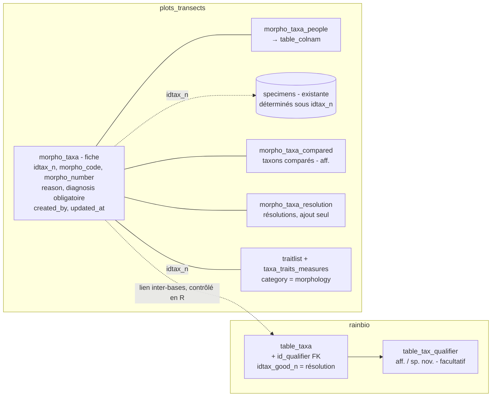

# Morpho-espèces dans cafriplotsR — note d'implémentation

Gilles Dauby · 2026-10-07 · note de conception

Note compagnon de [note de concept](design_note_morpho_species_concept.md). En résumé : le nom suit la forme Genre spN Auteur, numérotée par auteur ; le qualificatif, facultatif (aff. ou sp. nov.), devient une colonne clé étrangère vers une petite table de référence dans `rainbio` ; la fiche de la morpho-espèce est une table 1‑1 avec `table_taxa`, placée dans plots\_transects ; les utilisateurs autorisés à modifier le backbone créent directement les morpho-espèces, sous réserve d'une diagnose rédigée ; les critères morphologiques, facultatifs, sont des traits de catégorie `morphology` dans `traitlist`, stockés dans `taxa_traits_measures`.

## Point de départ dans le code

Le modèle s'appuie sur quatre briques existantes ; la contrainte structurante est que taxons et données vivent dans deux bases distinctes.

| Brique | Base | Ce qui existe | Conséquence pour les morpho-espèces |
| --- | --- | --- | --- |
| `table_taxa` | `rainbio` | `idtax_n`, `idtax_good_n` (synonymie), `id_parent` (hiérarchie), `tax_level`, `author1‑3`, `year_description`, flag booléen `morpho_species` ; journal `followup_updates_table_taxa` | La morpho-espèce reste une ligne de `table_taxa` ; la résolution réutilise `idtax_good_n` ; le flag reste le marqueur des morpho-espèces |
| `table_idtax` | `plots_transects` | Vue matérialisée `idtax_n → idtax_good_n` copiée depuis `rainbio`, rafraîchie manuellement | Toute résolution de morpho-espèce doit déclencher un rafraîchissement |
| `traitlist` + `taxa_traits_measures` (+ `_feat`) | `plots_transects` | Définition des traits (`valuetype` numeric / categorical / ordinal / character, `factorlevels`, `category`, bornes, unité) ; mesures par `idtax` avec `basisofrecord`, `measurementremarks`, `reference`, localité, date | Porte les critères morpho sans nouvelle table de mesures |
| `specimens` + `data_link_specimens`, `table_colnam` | `plots_transects` | Spécimen = `id_colnam` + `colnbr` (+ suffixe), détermination `idtax_n`, `detby`, `dety/m/d` ; lien spécimen ↔ individu ; personnes dans `table_colnam` | Auteurs pris ici ; les spécimens d'une morpho-espèce sont ceux déterminés sous son nom ; le cf. va sur la détermination |

Conséquence : une fiche de morpho-espèce placée dans `rainbio` pointerait vers des spécimens et des personnes de `plots_transects`, sans clé étrangère possible entre bases. D'où le choix, détaillé dans Modèle de données, de placer la fiche dans `plots_transects` : il ne reste qu'un lien inter-bases (`idtax_n`), contrôlé en R à l'écriture comme c'est déjà le cas pour `taxa_traits_measures.idtax`.

## Qualificatif : attribut ou table de référence

Recommandation : une table de référence `table_tax_qualifier` dans `rainbio`, et une colonne `id_qualifier` (clé étrangère, facultative : NULL pour un nom accepté, un synonyme ordinaire ou une morpho-espèce sans qualificatif) dans `table_taxa`. C'est le même schéma qu'un lookup `id_colnam`, mais la vraie raison est ailleurs : chaque qualificatif déclenche un comportement différent (espèce de référence exigée ou non, mode de description, exigences à l'enregistrement, format du nom, exportable comme nom valide ou non), et ces règles se lisent mieux dans une table que dans des `if` dispersés dans le code.

| Option | Pour | Contre |
| --- | --- | --- |
| Colonne texte avec `CHECK (qualifier IN ('aff.','sp. nov.'))` | Simple, lisible en SQL brut | Les règles par qualificatif restent codées en dur en R ; ajouter une valeur = migration du `CHECK` |
| **Table de référence + `id_qualifier` (recommandé)** | Règles stockées avec la valeur ; listes déroulantes Shiny générées depuis la table ; ajout d'une valeur sans toucher au code | Une jointure de plus pour l'affichage (négligeable : la table a 2 lignes) |
| Plusieurs booléens (`is_aff`, `is_spnov`…) | Aucun | États contradictoires possibles ; à écarter |

Contenu proposé de `table_tax_qualifier` :

| `qualifier` | `requires_ref_taxon` | `description_mode` | `required_at_save` | `exportable_as_valid` | `display_suffix` |
| --- | --- | --- | --- | --- | --- |
| `aff.` | TRUE | `differential` | diagnose différentielle + espèce de référence | FALSE | `aff. {ref_esp}` |
| `sp. nov.` | FALSE | `absolute` | diagnose | FALSE | `sp. nov.` |

Sans qualificatif, la règle par défaut s'applique : seule la diagnose en texte libre est exigée, et les critères éventuels sont saisis en mode `absolute`. Dans tous les cas, les critères morphologiques sont facultatifs. `check_morpho_completeness()` vérifie ces règles.

### Ce que contient `tax_esp`

Point délicat : beaucoup de fonctions existantes lisent `tax_gen` + `tax_esp` (détection de doublons, `.taxon_level()`, appariement de noms). Une morpho-espèce doit donc avoir un `tax_esp` non vide (sinon elle serait classée au rang genre) et qui ne puisse jamais être confondu avec un nom publié.

| Cas | `tax_esp` | `author1` | Nom affiché (`format_taxon_name()`) |
| --- | --- | --- | --- |
| sans qualificatif | `sp1` | `Dauby` | *Diospyros* sp1 Dauby |
| aff. | `sp1` | `Dauby` | *Diospyros* sp1 Dauby aff. *iturensis* |
| sp. nov., sans nom latin | `sp2` | `Dauby` | *Diospyros* sp2 Dauby sp. nov. |
| sp. nov., nom latin choisi | `nova` | `Dauby` | *Diospyros nova* sp. nov. |

`tax_esp` contient « sp » suivi du numéro, sans espace : il ne peut pas être confondu avec une épithète publiée, et un code ancien qui ignore `id_qualifier` affiche quand même, avec `author1`, un nom sans ambiguïté. Le qualificatif n'est plus écrit dans `tax_esp` : il vient de `id_qualifier` et, pour aff., de l'espèce de référence (`morpho_taxa_compared.is_primary`). `format_taxon_name()` assemble le nom complet, et tout affichage doit passer par elle. Le choix d'un nom latin pour une sp. nov. remplace `sp2` par l'épithète dans `tax_esp` (l'ancien nom va dans `legacy_name`) ; `idtax_n` ne change pas. Le risque est alors qu'un code ancien affiche *Diospyros nova* comme un nom accepté, d'où la même règle d'affichage. Toute morpho-espèce, avec ou sans qualificatif, peut être rattachée à un nom existant par `idtax_good_n`.

**Numérotation par auteur.** Le numéro est propre au premier auteur dans un genre : *Diospyros* sp1 Dauby et *Diospyros* sp1 Lachenaud coexistent. `author1` porte les auteurs de la morpho-espèce (chaîne abrégée dérivée de `morpho_taxa_people`, jamais l'auteur de l'espèce de référence). `next_morpho_number()` calcule le numéro suivant : le plus grand numéro déjà utilisé par ce premier auteur dans ce genre, morpho-espèces résolues comprises, plus un ; un numéro n'est donc jamais réattribué. Le numéro est conservé dans `morpho_taxa.morpho_number`. Côté `rainbio`, un index unique partiel sur `(tax_gen, tax_esp, author1) WHERE morpho_species` bloque les doublons. `year_description` porte l'année du nom : par défaut l'année de création dans la base, modifiable quand la morpho-espèce a été décrite avant d'être saisie. Si une morpho-espèce change de genre, elle reçoit le numéro suivant dans la série de son auteur pour le nouveau genre ; `morpho_code` ne change pas.

### Le flag `morpho_species`

Il reste le marqueur des morpho-espèces : le qualificatif étant facultatif, `id_qualifier IS NOT NULL` ne suffit pas à les reconnaître. `backbone_matching.R`, `census_taxon_revision.R` et les modules Shiny continuent de le lire ; un trigger impose `morpho_species = TRUE` dès qu'une ligne porte un `id_qualifier`.

### Le cas de cf.

cf. n'entre pas dans `table_tax_qualifier` : il qualifie une détermination. Il devient une colonne `identification_qualifier TEXT CHECK (identification_qualifier IN ('cf.'))` sur `specimens` et sur la table qui porte la détermination des individus, à côté de `idtax_n`, `detby`, `dety`. Une seule valeur et aucun comportement associé : un `CHECK` suffit ici, et il vit dans `plots_transects`, là où sont les déterminations. Un individu peut ainsi être « cf. *Genre* aff. *iturensis* ».

## Modèle de données

Recommandation : seuls le qualificatif et la résolution restent dans `rainbio`, avec le nom ; la fiche et ses tables satellites vont dans `plots_transects`. Les liens vers `specimens` et `table_colnam` deviennent de vraies clés étrangères, et il ne reste qu'un lien inter-bases (`idtax_n`), exactement comme pour `taxa_traits_measures`. La fiche ne contient aucune information géographique : la répartition se déduit des spécimens et des individus identifiés sous le nom.



*Modèle de données : la fiche vit avec les données (plots_transects), le qualificatif avec le nom (rainbio). Les nouvelles tables sont celles préfixées `morpho_` et `table_tax_qualifier`.*

Le pointillé est le seul lien sans clé étrangère ; il est vérifié en R à l'écriture et par une fonction de contrôle périodique (fiches orphelines, morpho-espèces sans fiche).

### `morpho_taxa` (une ligne par morpho-espèce)

| Colonne | Type | Rôle |
| --- | --- | --- |
| `idtax_n` | INTEGER, PK | Renvoie à `table_taxa.idtax_n` (rainbio) |
| `morpho_code` | TEXT, UNIQUE, NOT NULL | Code stable `MS-0001`, généré par séquence, jamais réutilisé |
| `morpho_number` | INTEGER, NOT NULL | Numéro dans la série du premier auteur pour le genre (le N de spN), attribué par next\_morpho\_number(), jamais réattribué |
| `reason` | TEXT, CHECK | `sterile`, `unmatched_fertile`, `potential_new`, `unresolved_complex` |
| `diagnosis` | TEXT, NOT NULL | Diagnose en texte libre, obligatoire (différentielle pour aff.) |
| `created_by`, `created_at` | TEXT défaut `current_user`, TIMESTAMPTZ défaut `now()` | Qui l'a saisie, quand |
| `updated_at` | TIMESTAMPTZ, tenu par trigger | Dernière modification |

La résolution n'est pas une colonne de la fiche : elle vient de `morpho_taxa_resolution`, et le statut est calculé (voir Droits et statut).

### Tables satellites

| Table | Colonnes | Contraintes |
| --- | --- | --- |
| `morpho_taxa_people` | `idtax_n`, `id_colnam` (FK `table_colnam`), `role` (`author`), `author_order` | PK (`idtax_n`, `id_colnam`, `role`) ; au moins un `author` exigé à la création |
| `morpho_taxa_compared` | `idtax_n`, `idtax_compared`, `is_primary`, `note` | Index unique partiel : une seule espèce `is_primary` ; obligatoire si qualificatif aff. |
| `morpho_taxa_resolution` | `idtax_n`, `resolution_type`, `note`, `decided_by`, `decided_at` | Ajout seul ; `decided_by` et `decided_at` forcés par trigger |

**Pas de table de liaison pour les spécimens, ni de spécimen de référence.** La création d'une morpho-espèce n'exige aucun spécimen : souvent, elle est créée d'abord, puis des spécimens sont déterminés sous ce nom. Les spécimens d'une morpho-espèce se retrouvent donc par leur détermination (`specimens.idtax_n`, résolue par `table_idtax`), sans table dédiée qui ferait doublon. Il n'y a pas de spécimen de référence unique : tous les spécimens déterminés sous la morpho-espèce la documentent. Faut-il que la description cite des spécimens ? La question reste ouverte (note de concept).

`created_by` et `decided_by` stockent l'utilisateur PostgreSQL connecté (rattachable à `user_registry`), pas une personne de `table_colnam` : ils disent qui a saisi et qui a décidé dans la base, alors que `morpho_taxa_people` dit qui sont les auteurs botaniques. Les deux peuvent différer.

La base ne gère pas d'images : aucun champ média n'est prévu, et ce sont les spécimens déterminés sous la morpho-espèce qui servent de support de comparaison. Les modifications de ces tables sont journalisées dans une table `followup_updates_morpho_taxa`, sur le modèle des `followup_updates_*` existantes.

## Droits et statut

Les utilisateurs autorisés à modifier le backbone créent directement les morpho-espèces, et une morpho-espèce n'est enregistrée que si sa diagnose est rédigée (et, pour une aff., son espèce de référence choisie) ; les critères morphologiques restent facultatifs. Le droit est celui que l'appli backbone teste déjà, `INSERT` sur `table_taxa` (`has_table_privilege(current_user, 'table_taxa', 'INSERT')`). Aucun rôle PostgreSQL nouveau n'est nécessaire, ce qui convient au serveur OVH, où les rôles ne se créent que depuis le portail.

- **Droits** : `grant_morpho_permissions(username)`, à ajouter dans `user_management.R`, accorde par `GRANT` `INSERT` et `UPDATE` sur `morpho_taxa`, ses tables satellites et `taxa_traits_measures` aux utilisateurs qui ont déjà `INSERT` sur `table_taxa`. Le propriétaire des tables peut l'accorder, comme le fait déjà `setup_user()`.
- **Garde-fou** : `add_morpho_taxon()` et l'assistant Shiny refusent l'enregistrement tant que `check_morpho_completeness()` ne passe pas. C'est la seule barrière ; elle est en R, parce que les règles sont dans `rainbio` et les critères dans `plots_transects`.
- **Traçabilité** : `created_by` et `created_at` sur la fiche, journal `followup_updates_morpho_taxa` pour chaque modification, trigger `BEFORE UPDATE` qui tient `updated_at` à jour. Créer ces triggers ne demande que d'être propriétaire des tables ; il faut vérifier que `plpgsql` est disponible sur l'instance OVH.

### Statut

Le statut n'est pas saisi : une vue `v_morpho_taxa_status` le calcule.

| Statut | Condition |
| --- | --- |
| `incomplete` | Diagnose absente ; n'existe que pour les morpho-espèces reprises de l'existant |
| `active` | Diagnose rédigée, aucune résolution |
| `resolved` | Une ligne dans `morpho_taxa_resolution` |

`morpho_taxa_resolution` (`idtax_n`, `resolution_type` CHECK `linked` / `merged` / `published` / `discarded`, `note`, `decided_by` défaut `current_user`, `decided_at` défaut `now()`) est une table en ajout seul : ni `UPDATE` ni `DELETE` ne sont accordés, et un trigger `BEFORE INSERT` force `decided_by` et `decided_at`. Elle garde ainsi qui a résolu quoi, et quand.

### Résolution

`resolve_morpho_taxon(idtax_n, to_idtax_n = NULL, type = c("linked", "merged", "published"), note)` :

1. Dans `rainbio` : les trois types posent `idtax_good_n = to_idtax_n`. Pour `published`, `to_idtax_n` est le nom publié, ajouté au backbone comme nouvelle entrée s'il n'y est pas déjà. La ligne de la morpho-espèce n'est pas modifiée (nom, auteurs et qualificatif conservés) : par exemple, *Tessmannia* 'microphylla' sp. nov. reste dans le backbone, synonyme de *Tessmannia microphylla*.
2. Dans `plots_transects` : une ligne dans `morpho_taxa_resolution`, avec `resolution_type` et une note.
3. `REFRESH MATERIALIZED VIEW table_idtax`, pour que les individus suivent le nom retenu.

Les deux bases ne partagent pas de transaction : la fonction exécute les étapes dans cet ordre, en `dry_run = TRUE` par défaut, et une fonction de contrôle détecte les états incohérents (fiche `resolved` dont le taxon n'a pas d'`idtax_good_n`, et inversement).

### Effet sur les extractions

Les fonctions d'enrichissement taxonomique ajoutent les colonnes `tax_qualifier` et `morpho_status`. Les fonctions de requête gagnent un argument `morpho = c("all", "complete", "none")` : `all` par défaut, avec les fiches incomplètes signalées par `morpho_status = "incomplete"` ; `complete` les écarte ; `none` remplace les morpho-espèces par leur genre.

## Critères morphologiques via les traits

Les 52 critères deviennent des lignes de `traitlist` avec `category = 'morphology'`, et leurs valeurs des lignes de `taxa_traits_measures` ; les fonctions existantes (`query_taxa_traits()`, pivots, import de traits) les lisent sans modification. Trois ajouts sont nécessaires : une table de configuration, le lien au spécimen et le marqueur diagnostique.

### Définition des critères

- **Dans `traitlist`** : un trait par critère, nom préfixé (`morpho_bark_aspect`, `morpho_slash_colour`…), `valuetype` `categorical` avec les états dans `factorlevels`, `numeric` avec `expectedunit` et bornes, ou `character` pour les champs libres courts.
- **Critères numériques en min–max** : deux traits (`morpho_lamina_length_min`, `morpho_lamina_length_max`). Plus simple à saisir, à valider (min ≤ max) et à comparer qu'une série de mesures dont on déduit l'intervalle. Les mesures par spécimen restent possibles plus tard sur le trait de base.
- **Polymorphisme** : un critère catégoriel à plusieurs états = plusieurs lignes de mesure pour le même taxon et le même trait, comme pour les formes de croissance aujourd'hui.
- **Table `morpho_criteria_config`** (`id_trait`, `organ`, `priority` 1–3, `display_order`) dans `plots_transects` : elle porte ce qui est propre à l'usage morpho (regroupement par organe, priorité, ordre d'affichage) sans alourdir `traitlist`, qui reste générique. La grille Shiny la lit ; aucun critère n'est exigé à l'enregistrement.

### Ce que porte chaque valeur

| Information | Où | Remarque |
| --- | --- | --- |
| Taxon, critère, valeur | `idtax`, `fk_id_trait`, `traitvalue` / `traitvalue_char` | Existant |
| Base de l'observation | `basisofrecord` | Vocabulaire Darwin Core : `PreservedSpecimen` (herbier), `HumanObservation` (terrain), `MaterialCitation` (flore, littérature) |
| Spécimen observé | nouvelle colonne `id_specimen` (FK `specimens`, nullable) | Recommandé plutôt qu'un trait de `_feat` : vraie clé étrangère, et utile au-delà des morpho-espèces |
| Critère diagnostique (aff.) | feature `morpho_diagnostic` dans `taxa_traits_measures_feat` | Marque les critères déclarés comme différentiels ; pas de changement de schéma |
| Source bibliographique | `reference` | Pour les valeurs de l'espèce de référence reprises d'une flore |

### Mode différentiel pour aff.

On stocke toujours des valeurs absolues, jamais une différence : pour *Genre* aff. *iturensis*, la ligne dit « limbe 18–25 cm », pas « plus grand ». Le sens de la différence est calculé à l'affichage en comparant aux valeurs de l'espèce de référence (`morpho_taxa_compared.is_primary`). Conséquences :

1. Pour une aff., seuls les critères différentiels sont saisis et marqués `morpho_diagnostic` ; un critère absent est affiché « comme la référence ».
2. Si l'espèce de référence n'a pas de valeurs dans la base, la grille propose de les saisir aussi, sur l'espèce nommée, avec `basisofrecord = 'MaterialCitation'` et la flore en `reference`. La base s'enrichit au passage de descriptions d'espèces publiées.
3. Le jour où l'aff. devient sp. nov., la description est complétée en mode absolu sur les mêmes lignes, sans conversion.

## Reprise des morpho-espèces existantes

Le cache local du référentiel (copie de `table_taxa`, environ le 25 septembre 2026, 365 106 taxons) contient environ 500 noms informels, rangés ci-dessous en 14 formes de nom. Le volume est modeste ; le vrai problème est l'hétérogénéité de l'écriture, une vingtaine de conventions coexistant. Pour environ 330 noms, le qualificatif cible se déduit du nom par script ; c'est le cas des 164 sp. nov. sans nom latin, qui sont des espèces nouvelles potentielles et restent sp. nov. Environ 120 noms demandent une revue, dont l'ampleur réelle dépend de l'usage de chaque taxon. Le cache ne contient ni le flag `morpho_species`, ni l'usage (individus, spécimens) : ces deux informations demandent la base.

### Ce qu'on observe déjà

Détection par expressions régulières sur `tax_esp` et `tax_gen` (hybrides « × » et cultivars exclus). La liste complète, une ligne par taxon avec sa forme, est dans `morpho_existants_cache_2026-09.csv` à la racine du package.

| Forme du nom | Taxons | Exemples | Qualificatif cible | Traitement |
| --- | --- | --- | --- | --- |
| sp. nov. + nom latin | 7 | *Guarea tripelata* sp. nov. ; *Angraecum biteaui* sp. nov. ined. | sp. nov., nom latin choisi (`tax_esp` = épithète seule) | Script, contrôle rapide |
| sp. nov. + aff. / near | 29 | *Alchornea* sp.nov. near *hirtella* ; *Polystachya* aff. *kubale* sp. nov. | sp. nov. ; l'espèce citée devient l'espèce comparée principale | Semi-automatique : espèce extraite du nom et appariée au backbone |
| sp. nov. + collecteur, localité ou description | 91 | *Hermannia* spec.nov. =Friis 2977 ; *Impatiens* spec. nov. (Chaillu) ; *Palisota* spec.nov. gabon-decumbent | sp. nov. sans nom latin | Script : auteur repris, numéro attribué dans sa série ; l'ancien libellé va dans `legacy_name` |
| sp. nov. numéroté | 39 | *Keetia* spec.nov.1 ; *Psychotria* sp.nov.10 | sp. nov. sans nom latin | Script : numéro conservé s'il est libre dans la série de l'auteur, sinon renuméroté ; ancien nom dans `legacy_name` |
| sp. nov. nu | 34 | *Microcoelia* sp. nov. ; *Salacia* sp. nov. | sp. nov. sans nom latin | Script + complément : auteur à attribuer, puis numéro dans sa série |
| aff. | 76 | *Cola* aff nitida ; *Garcinia* sp11 aff conrauana ; *Keetia* sp. aff. molundensis | aff. | Semi-automatique : espèce de référence extraite et appariée au backbone |
| sp. + numéro + localité | 54 | *Millettia* sp1 sanaga ; *Xylopia* sp1 Sanaga | morpho-espèce sans qualificatif | Script : numéro conservé ou renuméroté dans la série de l'auteur ; la localité va dans `legacy_name` |
| sp. + numéro | 30 | *Artabotrys* sp.2 ; *Ardisia* sp. no 3 | morpho-espèce sans qualificatif | Revue (doublons possibles entre sites) |
| sp. + lettre (style flores) | 45 | *Chisocheton* species a ; *Aporosa* spec. c | morpho-espèce sans qualificatif | Revue ; souvent issus de flores, spécimens cités retrouvables |
| sp. seul | 15 | *Anthocleista* sp ; *Tetraria* sp. | pas une morpho-espèce : identification au genre | Script : rattachement au genre |
| cf. ou « ? » | 27 | *Sterculia* cf. pruriens ; *Cassia leiandra* ? | pas une morpho-espèce : déterminations incertaines | Script : rattachement au taxon nommé, `identification_qualifier = 'cf.'` sur les déterminations |
| genre inconnu | 10 | Rub unknown sp.1 ; unknown GD2639 | morpho-genre (question ouverte) | Décision à prendre |
| codes de terrain | 21 | *Dactyladenia* 13b1, 26a, 28d ; *Drypetes* 1 MtMbilan | morpho-espèce sans qualificatif | Revue (codes d'une révision en cours ?) |
| autres sp. (section, description) | 22 | *Bulbophyllum* sp. (Desmosanthes) ; *Phreatia* sp. sbgo 3330 | morpho-espèce sans qualificatif | Revue |

Trois constats complètent le tableau :

- **`author1` n'a pas de sens stable.** Pour *Millettia* sp1 sanaga, c'est l'auteur de la morpho-espèce (Djonko) ; pour *Keetia* sp. aff. molundensis, c'est l'auteur de l'espèce de référence ((K.Krause) Bridson). La reprise doit déplacer les auteurs de morpho-espèces vers `morpho_taxa_people` et vider `author1` quand il appartient à l'espèce de référence, puis y écrire les auteurs de la morpho-espèce ; year\_description reçoit l'année du nom, à défaut l'année de création du taxon dans la base.
- **Seuls 11 de ces taxons sont déjà synonymes** (`idtax_good_n` renseigné) : la quasi-totalité reste à traiter.
- **Les familles les plus concernées** sont les *Rubiaceae* (61), les *Fabaceae* (55), les *Orchidaceae* (41), puis les *Sapindaceae*, *Euphorbiaceae* et *Sapotaceae* (environ 20 chacune). Elles se prêtent à une revue par lots, famille par famille.

Ce repérage par la forme du nom a deux limites, que seule la base peut lever : un morpho-taxon au nom d'apparence normale passe inaperçu, et un nom informel n'est pas forcément marqué `morpho_species`. Le diagnostic doit croiser les deux listes.

Le code d'import OpenForis (`openforis_new_plot_processing.R`) fabrique le nom en accolant l'identification de terrain et l'étiquette morpho de la campagne (« *Drypetes* sp. » + « sp1 »). Ces étiquettes sont locales à une campagne : deux « *Drypetes* sp1 » de deux sites peuvent être deux taxons différents, et inversement un même taxon peut porter deux étiquettes. Enfin, le taxon d'un individu peut venir de deux sources, sa propre détermination (`data_individuals.idtax_n`) ou celle du spécimen lié (`idtax_individual_f`) ; le diagnostic doit compter les deux.

### Étape 0 : diagnostic en lecture seule

Une fonction `diagnose_morpho_taxa()` produit un tableau, une ligne par morpho-taxon existant, avec :

- la forme du nom (colonne `cat` du fichier CSV) ;
- le statut de synonymie (`idtax_good_n` renseigné ou non) ;
- le nombre d'individus (par les deux voies), de parcelles, de pays et de recensements où il apparaît ;
- le nombre de spécimens déterminés sous ce nom, et parmi eux ceux déposés en herbier ;
- le nombre de mesures de traits ;
- les autres morpho-taxons du même genre présents dans les mêmes pays (doublons possibles entre sites).

Les formes de nom sont déjà classées (tableau ci-dessus). Côté `rainbio`, il reste à croiser ce classement avec le flag :

```r
flag <- data.table::as.data.table(DBI::dbGetQuery(con_taxa,
  "SELECT idtax_n, morpho_species FROM table_taxa"))
forms <- data.table::fread("morpho_existants_cache_2026-09.csv")
check <- merge(flag[morpho_species == TRUE], forms, by = "idtax_n", all = TRUE)
# flagués sans forme reconnue  -> morpho-taxons au nom d'apparence normale
# forme reconnue sans flag      -> noms informels non marqués
check[, .N, by = .(flagged = !is.na(morpho_species), form = !is.na(cat))]
```

Les comptages d'usage réutilisent la logique qui calcule `idtax_individual_f` dans `functions_manip_db.R`, plutôt qu'une requête SQL réécrite à part. Le classement des formes de nom est un point de départ : quelques cas limites seront à reclasser à la main pendant la revue.

### Tri en catégories

La forme du nom donne le qualificatif cible ; l'usage donne la priorité et l'effort. Le tri croise les deux :

| Catégorie | Critère de tri | Traitement | Qui |
| --- | --- | --- | --- |
| A — déjà résolues | `idtax_good_n` renseigné (11 dans le cache) | Qualificatif posé, résolution `linked` importée par script ; pas de fiche à remplir | Script |
| B — pas des morpho-espèces | sp. seul, cf., « ? » (42 dans le cache) | Rattachement au genre ou au taxon nommé ; cf. reporté sur les déterminations | Script + contrôle |
| C — orphelines | Aucun individu, aucun spécimen, aucun trait | Liste soumise pour décision : résolution `discarded` (réservée à la reprise) ou conservation | Script + décision |
| D — forme décidable | Toutes les sp. nov. (avec ou sans nom latin), aff., sp. + numéro + localité (environ 330 dans le cache) | Qualificatif et espèce de référence posés par script ; fiche `incomplete` à compléter (auteurs et diagnose ; critères si disponibles) | Script + complément |
| E — à revoir | sp. + numéro ou lettre, codes de terrain, autres (environ 120 dans le cache) | Revue experte : qualificatif, auteurs, fusion des doublons entre sites | Experts du groupe, par lots |
| F — genre inconnu | 10 dans le cache | Selon la décision sur les morpho-genres | À trancher |

Seule E demande du temps d'expert, et D un complément de fiche. Elles se traitent famille par famille dans `mod_morpho_review`, en commençant par les taxons qui ont le plus d'individus, puisque ce sont eux qui pèsent dans les analyses. Le volume de D et E et le temps par taxon ne sont pas estimables sans le diagnostic : un premier lot pilote sur un genre riche en morpho-taxons donnera le temps moyen par taxon et permettra de chiffrer le reste.

### Ce qu'il faut ajouter au modèle pour la reprise

- **`legacy_name`** dans `morpho_taxa` : l'ancien nom (« *Anthonotha* sp1 Bouamir ») reste consultable et utilisable pour retrouver les jeux de données déjà exportés ou publiés sous ce nom. Le renommage ne change pas `idtax_n`, donc les individus ne sont pas touchés.
- **`discarded`** comme type de résolution, réservé aux orphelines de la catégorie C.
- **Table `morpho_field_alias`** (`label`, campagne ou site, `idtax_n`) : elle fait correspondre les étiquettes de terrain (« sp1 » d'une campagne OpenForis) à une morpho-espèce existante. L'import OpenForis s'en sert au lieu de créer un nouveau taxon à chaque campagne, ce qui évite de recréer le problème après la reprise.

## Fonctions R, modules Shiny et migration

Toutes les fonctions qui écrivent suivent les conventions du package : `dry_run = TRUE` par défaut, sauvegarde avant modification, data.table pour les manipulations, journalisation dans les `followup_updates_*`.

### Fonctions R

| Fonction | Rôle |
| --- | --- |
| `add_morpho_taxon()` | Crée la ligne `table_taxa` (via `.add_taxa_noninteractive()`), la fiche, les satellites et les critères en un appel ; attribue le numéro par `next_morpho_number()` et construit `tax_esp` ; refuse si `check_morpho_completeness()` échoue |
| `next_morpho_number()` | Numéro suivant pour un genre et un premier auteur, morpho-espèces résolues comprises |
| `format_taxon_name()` | Nom d'affichage unique, qualificatif compris ; à utiliser partout à la place de `paste(tax_gen, tax_esp)` |
| `get_morpho_fiche()` | Renvoie la fiche complète (liste : fiche, auteurs, spécimens, taxons comparés, critères par organe) |
| `compare_morpho_taxa()` | Tableau large critère × taxon pour 2 à 4 taxons, avec le sens des différences |
| `find_morpho_candidates()` | Morpho-espèces d'un genre compatibles avec quelques critères observés (petite clé multi-accès) |
| `list_genus_morpho()` | Morpho-espèces d'un genre avec auteurs, année, qualificatif, statut, nombre de spécimens et d'individus identifiés ; alimente l'assistant de création |
| `check_morpho_completeness()` | Vérifie la présence de la diagnose (et de l'espèce de référence pour une aff.) ; renvoie ce qui manque |
| `resolve_morpho_taxon()` | Résolution sur les deux bases + rafraîchissement de `table_idtax` |
| `check_morpho_integrity()` | Contrôles inter-bases : fiches orphelines, morpho-espèces sans fiche, résolutions incohérentes |
| `export_morpho_fiche()` | Fiche HTML/PDF (et tableur pour une liste) |
| `grant_morpho_permissions()` | Accorde ou retire par `GRANT` l'écriture sur les tables morpho, aux utilisateurs qui ont déjà `INSERT` sur `table_taxa` |

### Modules Shiny (appli backbone)

- **Nouveaux** : `mod_morpho_add` (assistant : dès le choix du genre, il liste les morpho-espèces existantes de ce genre avec nom, auteurs, année, qualificatif, statut, nombre de spécimens et d'individus identifiés, avec accès à leur fiche et à la comparaison ; réutilise `mod_specimen_lookup` et la recherche de taxons), `mod_morpho_view` (fiche), `mod_morpho_compare`, `mod_morpho_review` (liste des fiches incomplètes de la reprise, à compléter famille par famille). Les onglets d'écriture n'apparaissent que si `has_table_privilege(current_user, 'table_taxa', 'INSERT')`, comme aujourd'hui.
- **Modifiés** : `mod_taxa_add` (la case « Morphotaxon » renvoie vers l'assistant), `mod_taxa_update` (le bouton bascule `morpho_species` reste, et un sélecteur de qualificatif facultatif s'y ajoute), `mod_taxa_search` (affiche qualificatif et statut).

### Plan de migration

Une branche de fonctionnalité par étape, chacune livrable seule :

1. **rainbio** — `table_tax_qualifier`, colonne `id_qualifier`, trigger de synchronisation de `morpho_species`. Précédé du diagnostic en lecture seule (voir Reprise des morpho-espèces existantes).
2. **plots\_transects** — tables `morpho_taxa*` (dont `morpho_taxa_resolution`), vue `v_morpho_taxa_status`, `morpho_criteria_config`, colonne `taxa_traits_measures.id_specimen`, triggers d'horodatage, `GRANT` aux utilisateurs du backbone, journal ; chargement des 52 critères dans `traitlist`.
3. **Fonctions R** et tests (`testthat`), y compris les refus faute de droits et faute de diagnose.
4. **Modules Shiny**.
5. **Fiches pour les morpho-espèces existantes** : catégories A à D par script, catégorie E en revue experte par lots, famille par famille ; adaptation de l'import OpenForis à `morpho_field_alias`.
6. **Bascule** : fonctions de requête avec l'argument `morpho`, `backbone_matching.R` et `census_taxon_revision.R` adaptés à `id_qualifier` et à la nouvelle forme des noms. `morpho_species` est conservé comme marqueur.
7. **Ajout de `identification_qualifier`** (cf.) sur les déterminations ; indépendant, peut se faire à tout moment.

### Points à trancher avant de coder

- [x] Critères numériques : paire de traits `_min` / `_max` (proposé) ou mesures par spécimen.
- [x] Liste exacte des tables portant la détermination des individus, pour y ajouter `identification_qualifier`.
