```{r, include = FALSE}
knitr::opts_chunk$set(
  collapse = TRUE,
  comment = "#>",
  eval = FALSE,
  echo = TRUE
)
```

## Introduction

La fonction `launch_taxonomic_match_app()` fournit une application Shiny interactive pour standardiser les noms taxonomiques contre le référentiel taxonomique des plantes d'Afrique centrale. Cette interface visuelle est idéale pour :

- Explorer et nettoyer les données taxonomiques de manière interactive
- Comprendre la qualité des appariements grâce au retour visuel
- Examiner manuellement les appariements incertains
- Enrichir les données avec des traits au niveau de l'espèce depuis la base de données
- Vérifier la provenance des noms taxonomiques auprès de référentiels externes (WCVP, APD)

## Prérequis

### Où s'exécute l'application

La même application existe à deux endroits, et cette vignette fait référence aux deux.

- **En local**, dans votre propre session R, via `launch_taxonomic_match_app()`. C'est ce que supposent les exemples de code ci-dessous.
- **Hébergée**, à l'adresse <https://cafri-taxomatch.lab.sspcloud.fr> — la même application servie depuis SSP Cloud, que vous ouvrez dans un navigateur, sans rien installer et sans R. Partout où cette vignette parle de *l'application hébergée*, il s'agit de cette adresse.

La copie hébergée interroge la même base de données : une liste standardisée qui en est exportée porte les mêmes valeurs d'`idtax_n` qu'une liste produite en local. Utilisez-la pour essayer l'application, ou pour montrer le flux de travail à un collègue sans lui demander d'installer le paquet. Pour un travail répété sur vos propres listes, le lancement en local est généralement plus rapide — voir [Appariement lent](#performance-de-correspondance-lente).

### Avec identifiants de base de données (accès complet)

Pour accéder à toutes les fonctionnalités, y compris l'enrichissement par les traits, des identifiants de base de données sont nécessaires (voir `setup_db_credentials()`). Au lancement, l'application présente un écran de connexion où vous saisissez vos identifiants.

### Sans identifiants

Depuis mars 2026, l'application peut être utilisée **sans aucun identifiant de base de données**, par deux voies distinctes.

**Compte public en lecture seule.** Cliquez sur **"Se connecter en tant qu'utilisateur public"** sur l'écran de connexion. L'appariement *et* l'enrichissement par les traits fonctionnent ; l'ajout ou la modification de données n'est pas possible. C'est la voie sans identifiants disponible partout, y compris dans l'application hébergée, et celle à privilégier si vous n'avez tout simplement pas de compte.

**Référentiel taxonomique en cache (hors ligne).** Cliquez sur **"Utiliser hors ligne (référentiel en cache)"** pour travailler à partir d'une copie locale du référentiel :

- L'appariement automatique et les suggestions approximatives fonctionnent via un référentiel local en cache
- La révision manuelle est entièrement fonctionnelle
- L'onglet Enrichissement par les traits est masqué (nécessite une connexion active)
- Un badge **"Lecture seule"** est affiché tout au long de la session

Le mode hors ligne prend tout son sens lorsque la base de données est inaccessible depuis l'endroit où vous travaillez. Il n'apparaît que si vous lancez l'application vous-même depuis R *et* qu'un cache a déjà été téléchargé. L'application hébergée ne le propose pas : le cache y résiderait sur le serveur et non sur votre machine — il ne résoudrait donc rien, et l'accès public couvre déjà le travail sans compte.

## Démarrage Rapide

Lancez l'application avec une seule commande :

```{r}
library(CafriplotsR)
launch_taxonomic_match_app()
```

Alternativement, pré-chargez vos données ou définissez des options :

```{r}
# Avec un data.frame R
my_data <- read.csv("inventaire_arbres.csv")
launch_taxonomic_match_app(data = my_data, name_column = "nom_espece")

# Lancer en anglais (le français est la langue par défaut)
launch_taxonomic_match_app(language = "en")

# Lister jusqu'à 40 suggestions par nom lors de la révision (20 par défaut)
launch_taxonomic_match_app(max_suggestions = 40)
```

Le seuil d'appariement n'est **pas** un argument de lancement : il se règle dans l'onglet Appariement auto, en pourcentage, et peut être modifié d'une exécution à l'autre. Voir [Ajuster l'appariement approximatif](#ajuster-la-correspondance-approximative).

## Guide Étape par Étape

### Phase 1 : Vue Initiale

Au premier lancement, vous verrez l'écran de connexion. Il propose les trois voies décrites dans les [Prérequis](#prérequis) : vos propres identifiants de base de données, le compte public en lecture seule, ou le référentiel taxonomique en cache (hors ligne).

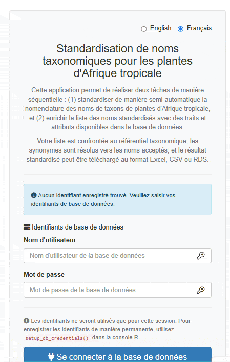

Après vous être authentifié (ou avoir choisi le mode hors ligne), l'interface principale apparaît avec une barre latérale pour la configuration et des onglets pour les différentes phases du flux de travail :

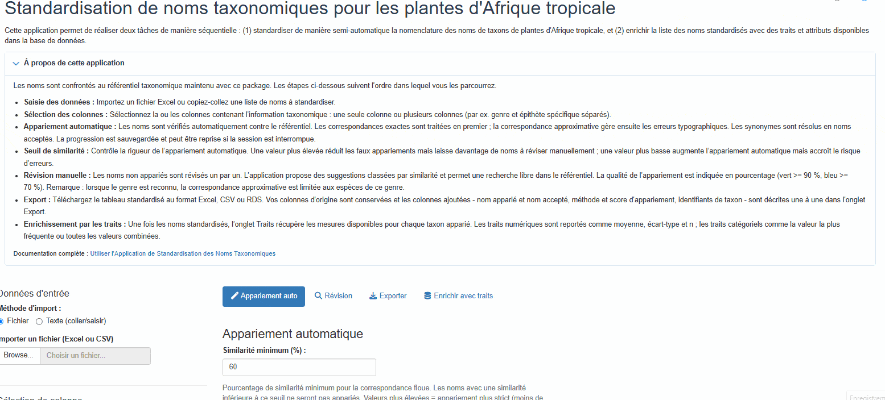

L'application utilise un **flux de travail par onglets** qui vous guide à travers chaque phase séquentiellement :

1. **Appariement auto** — Appariement automatique
2. **Révision** — Révision manuelle des noms non appariés
3. **Exporter** — Téléchargement des résultats
4. **Enrichir avec les traits** — Ajout de traits d'espèces (masqué en mode hors ligne)

### Phase 2 : Charger Vos Données

La première étape est de fournir vos données. L'application offre deux méthodes d'import :

#### Import par Fichier (Par Défaut)

- **Charger un fichier Excel** en utilisant le navigateur de fichiers (supporte .xlsx, .xls) ; pour les fichiers multi-feuilles, vous pouvez sélectionner la feuille à utiliser
- **Charger un fichier CSV**
- **Utiliser des données R pré-chargées** (si vous avez passé le paramètre `data`)

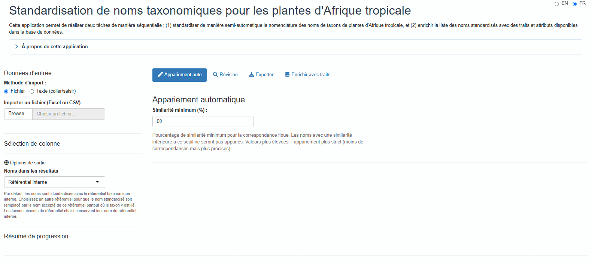

L'application affiche un aperçu de vos données chargées pour vérification. Les fichiers Excel sont lus avec `guess_max = 30000` pour améliorer la détection des types de colonnes sur les grands fichiers.

#### Saisie Texte (Copier-Coller)

Pour standardiser rapidement quelques noms, ou lorsque vous avez une liste copiée depuis une autre source, utilisez la méthode **Saisie texte** :

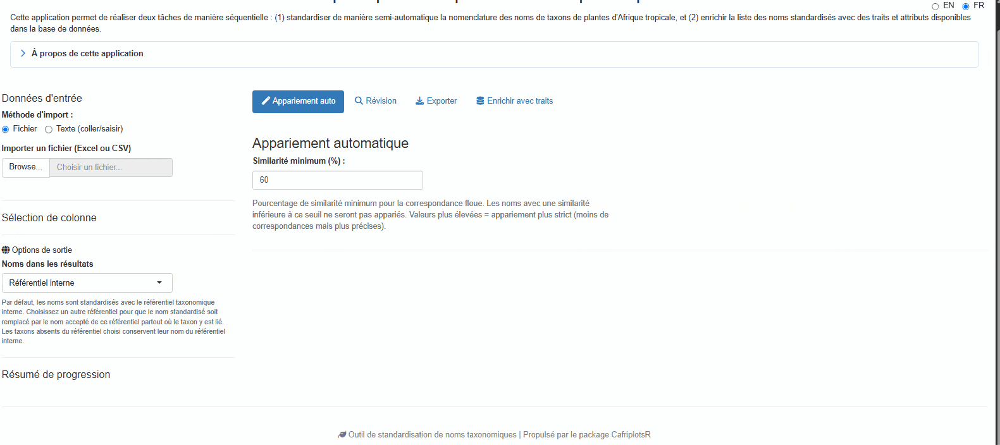

1. Sélectionnez **"Texte (coller/saisir)"** dans les boutons radio de méthode d'import
2. Collez ou tapez vos noms taxonomiques dans la zone de texte
3. Cliquez sur **"Charger les noms"** pour traiter la saisie

**Séparateurs acceptés :**
- Un nom par ligne (recommandé)
- Séparés par virgule : `Lophira alata, Terminalia superba, Aucoumea klaineana`
- Séparés par point-virgule : `Lophira alata; Terminalia superba; Aucoumea klaineana`
- Séparés par tabulation (utile lors du copier-coller depuis Excel)

L'application supprime automatiquement les lignes vides, les espaces superflus, et les doublons tout en préservant l'ordre. Une colonne unique nommée `taxon_name` est créée pour l'appariement.

### Phase 3 : Sélectionner la/les Colonne(s) de Noms

Une fois les données chargées, vous avez deux options pour sélectionner les noms taxonomiques :

#### Mode Colonne Unique (Par Défaut)

Sélectionnez une colonne contenant le nom taxonomique complet :

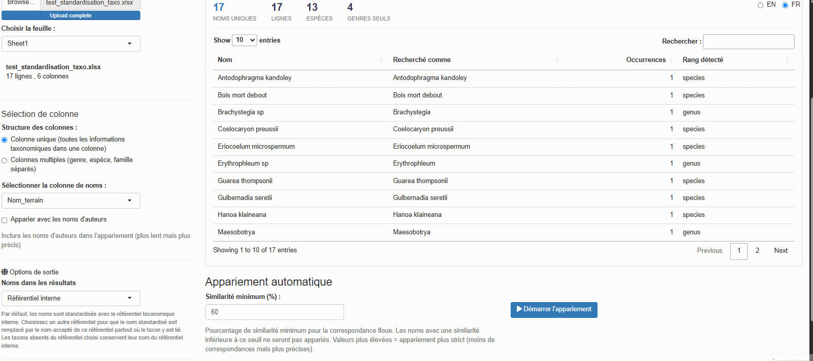

Le menu déroulant affiche toutes les colonnes disponibles de votre jeu de données. Choisissez celle contenant les noms d'espèces (généralement formatés comme "Genre espèce" ou "Genre espèce Auteur").

#### Mode Colonnes Multiples

Si vos données ont des colonnes séparées pour le genre, l'espèce et la famille, activez **"Utiliser plusieurs colonnes"** :

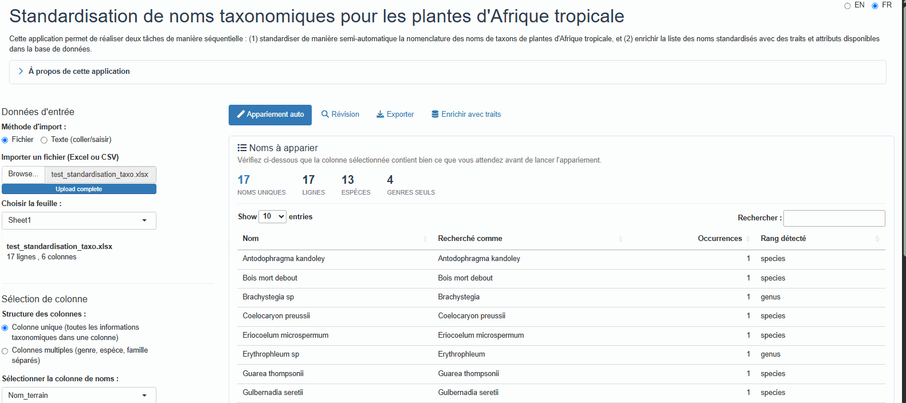

L'application combine ces colonnes de manière hiérarchique :
- Genre + espèce disponibles → "Genre espèce"
- Genre uniquement → "Genre"
- Famille uniquement → "Famille"

Vous pouvez aussi optionnellement inclure une colonne d'auteur.

### Phase 4 : Appariement automatique

Cliquez sur le bouton **"Démarrer l'appariement"** pour commencer le processus d'appariement automatique.

**Choix de la copie du référentiel.** Avant de démarrer, l'application peut demander s'il faut utiliser le référentiel taxonomique déjà en cache ou en télécharger une copie fraîche. La copie en cache est nettement plus rapide et convient à l'usage courant ; téléchargez une copie fraîche après l'ajout ou la révision de taxons dans la base, ou si vous ignorez l'âge de votre cache. La boîte de dialogue indique cet âge pour vous permettre de trancher.

L'application parcourt ensuite la stratégie ci-dessous, en s'arrêtant au premier niveau qui apparie chaque nom. Les noms sont traités indépendamment : une même liste peut donc renvoyer des résultats issus de tous les niveaux :

1. **Appariement exact sur l'espèce** : Recherche directe du nom complet (genre + espèce)
2. **Appariement exact sur le genre** : Appariement au niveau du genre
3. **Appariement exact sur la famille** : Appariement au niveau de la famille
4. **Appariement exact sur un rang supérieur** : Appariement au niveau de l'ordre ou de la classe (ex. noms se terminant en -opsida, -psida)
5. **Appariement approximatif contraint au genre** : Lorsque le genre est reconnu mais pas l'épithète, l'appariement approximatif est restreint aux espèces *de ce genre*. C'est ce niveau qui rattrape la plupart des fautes d'orthographe, et il est bien plus sûr qu'une recherche sur l'ensemble du référentiel puisque l'ensemble des candidats est déjà botaniquement plausible
6. **Appariement approximatif complet** : Comparaison de chaînes approximative (trigramme-Jaccard via `stringdist`) sur tout le référentiel — le dernier recours, employé lorsque même le genre n'est pas reconnu

Les niveaux 1 à 4 enregistrent tous `match_method = "exact"` ; le rang qui a effectivement apparié est consigné dans `tax_level`. Le niveau 5 enregistre `genus_constrained` et le niveau 6 `fuzzy`, d'où l'intérêt de les distinguer lors de la révision des résultats.

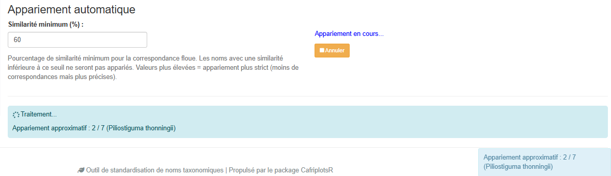

La barre de progression affiche le statut en temps réel et comptabilise correctement les noms révisés manuellement dans le pourcentage d'avancement. La barre latérale affiche des statistiques en direct :

- Nombre de appariements exacts
- Nombre de appariements au niveau du genre
- Nombre de appariements approximatifs
- Nombre de noms non appariés

**Point de reprise / checkpoint** : La progression de l'appariement est automatiquement sauvegardée dans un fichier temporaire. Si vous fermez accidentellement l'onglet du navigateur, rouvrir l'application proposera de reprendre là où vous vous étiez arrêté.

### Phase 5 : Examiner les résultats de l'appariement

À la fin de l'appariement, l'onglet Appariement auto affiche un **Résumé de l'appariement** : des effectifs, pas des lignes. Il indique comment s'est déroulée l'exécution, non ce qu'il est advenu de tel ou tel nom.

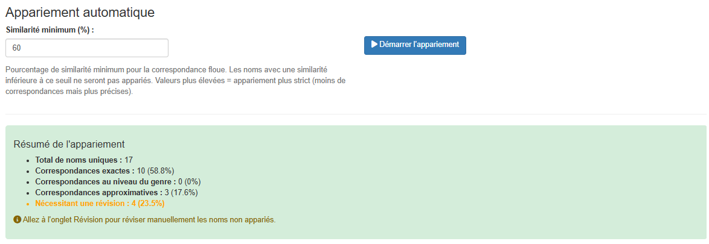

- **Total de noms uniques** soumis
- **Appariements exacts**, avec leur part du total
- **Appariements au niveau du genre**
- **Appariements approximatifs**
- **Nécessitant une révision** — affiché en orange dès que le chiffre dépasse zéro, avec un renvoi vers l'onglet Révision

Les résultats nom par nom ne sont pas dans cet onglet. Pour les consulter, deux endroits :

- L'onglet **Révision**, qui vous fait parcourir un à un les noms que l'appariement n'a pas su trancher.
- L'onglet **Exporter**, dont le tableau d'aperçu liste chaque ligne avec toutes ses colonnes — `corrected_name` (le nom à utiliser), `matched_name`, `match_method`, `match_score`, `idtax_n`, `is_synonym`, `accepted_name` et les autres. Voir [Comprendre les Colonnes de Sortie](#comprendre-les-colonnes-de-sortie) pour le contenu de chacune.

**Où sont les couleurs.** Les scores sont colorés sous forme de badges sur les cartes de l'onglet **Révision** — à côté de chaque suggestion approximative et de chaque résultat de recherche manuelle — et nulle part ailleurs. L'aperçu de l'onglet Exporter est un tableau ordinaire, sans coloration conditionnelle, et le Résumé de l'appariement ci-dessus ne contient aucun score individuel à colorer. Lisez les badges ainsi :

- **Appariement exact (100 %)** : appariement parfait, pas de révision nécessaire
- **Haute similarité (≥ 90 %, vert)** : très probablement correct, un coup d'œil suffit
- **Similarité moyenne (70–89 %, bleu)** : appariement possible, à lire
- **Basse similarité (< 70 %)** : incertain, à trancher à la main. Les cartes de suggestions approximatives colorent 50–69 % en jaune et le reste en gris ; les cartes de recherche manuelle passent directement au gris sous 70 %
- **Pas d'appariement** : nécessite une sélection manuelle

Un nom apparié par `genus_constrained` mérite plus de confiance qu'un `fuzzy` de score équivalent : les candidats auxquels il a été comparé étaient restreints aux espèces d'un genre que l'application avait déjà reconnu.

### Phase 6 : Révision Manuelle

Pour les noms non appariés ou incertains, passez à l'onglet **"Révision"** pour réviser manuellement et choisir le bon nom :

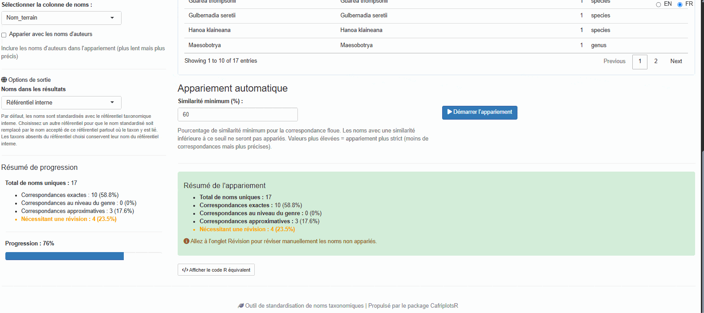

L'interface de révision fournit deux façons de trouver le bon nom :

#### Panneau de Suggestions Approximatives

Affiche des suggestions automatiques classées par similarité avec des options de filtrage avancées :

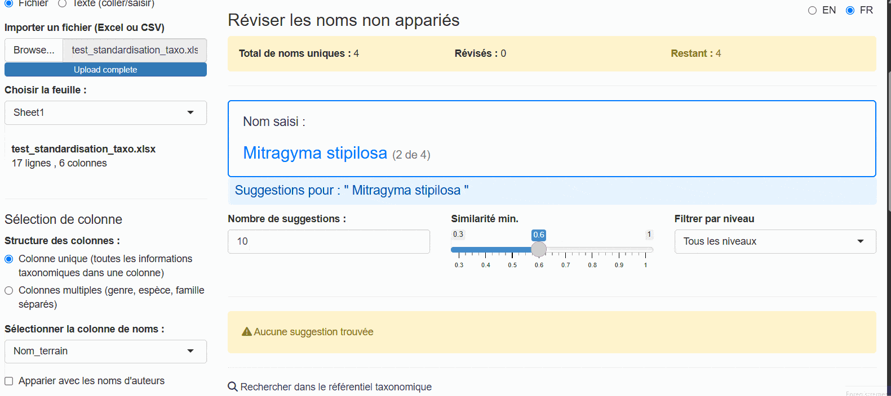

**Options de filtrage :**

- **Similarité min. (%)** : Ajuster le seuil (30–100 %), en pourcentage comme le champ de l'onglet Appariement auto. Il change seulement les suggestions affichées pour le nom en cours. Si aucune ne convient, baissez-le pour voir des noms moins ressemblants au vôtre. Le **?** à côté du curseur le rappelle dans l'application
- **Filtre de niveau taxonomique** : Filtrer par Tous, Espèce, Genre, Famille, Ordre, Classe ou Infraspécifique

Les suggestions sont toujours classées par score de similarité décroissant, la meilleure en premier. Le curseur choisit celles qui sont listées ; si plus de 20 le passent (faute de frappe dans un grand genre, seuil bas), les 20 meilleures sont affichées et une note le signale. Montez le curseur pour resserrer la liste, ou voyez `max_suggestions` plus bas pour changer cette limite.

Chaque carte de suggestion affiche :

- Nom avec badge de similarité coloré (vert ≥ 90 %, bleu ≥ 70 %, jaune ≥ 50 %, gris en dessous)
- Niveau taxonomique et famille
- Information de synonymie si applicable
- Bouton **Sélectionner** pour acceptation en un clic

#### Panneau de Recherche Manuelle

Pour les noms sans bonnes suggestions, utilisez la recherche manuelle :

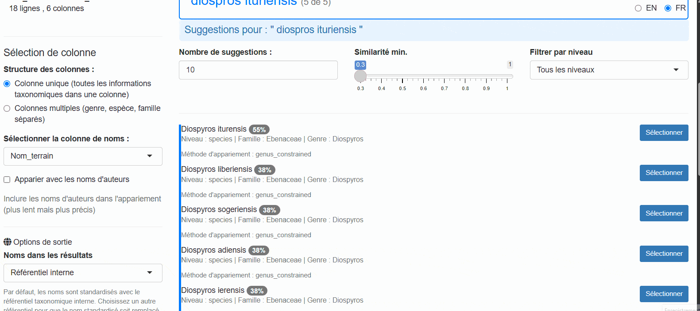

- Tapez n'importe quel terme de recherche pour interroger le référentiel taxonomique
- Filtrez les résultats par niveau taxonomique
- Consultez les informations détaillées pour chaque résultat
- Sélectionnez le bon nom ou marquez comme "non résolu"

**Navigation :**

- Utilisez les boutons **Précédent/Passer/Suivant** pour parcourir les noms non appariés
- Le compteur de progression affiche les noms révisés vs. restants
- L'application mémorise vos sélections et met à jour automatiquement les résultats

### Phase 7 : Exporter les Résultats

Passez à l'onglet **"Exporter"** pour télécharger votre jeu de données standardisé :

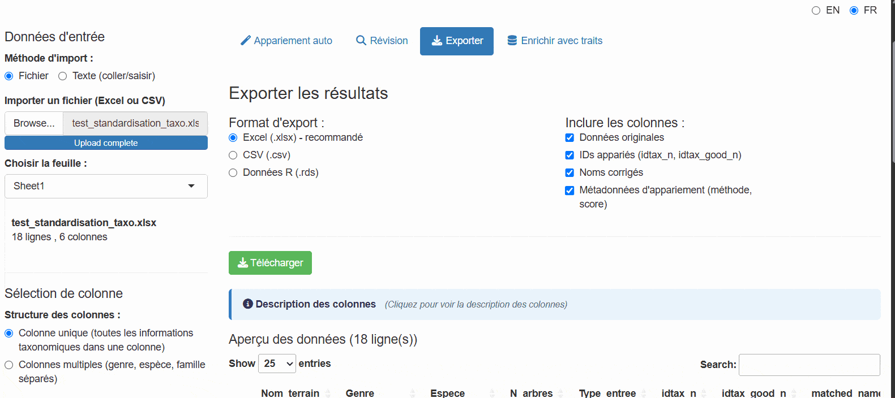

**Formats disponibles :**

- **Excel (.xlsx)** : Idéal pour partager avec des collaborateurs
- **CSV (.csv)** : Format tabulaire universel
- **RDS (.rds)** : Format natif R préservant les types de données

**Quelle colonne contient le nom à utiliser ?** `corrected_name`. L'onglet Exporter l'indique dans un encadré vert au-dessus de la description des colonnes, et [Quel nom utiliser ?](#quel-nom-utiliser) ci-dessous explique à quoi servent les autres colonnes de noms.

**Colonnes sélectionnables.** Vos colonnes d'origine sont toujours incluses ; les trois groupes ci-dessous peuvent chacun être désactivés :

- **Identifiants des taxons** — `idtax_n`, `idtax_good_n`
- **Noms standardisés** — `corrected_name`, `matched_name`
- **Détails de l'appariement** — `match_method`, `match_score`, `is_synonym`, `accepted_name`

Les colonnes de référentiel ne constituent pas l'un de ces groupes : elles sont ajoutées dès lors qu'un référentiel autre que l'interne avait été choisi avant l'appariement, et accompagnent l'export dans tous les cas. L'identifiant de ligne interne `id_data` est toujours retiré.

**Ce que contient le fichier.** L'export Excel place les noms sur une feuille nommée `taxonomy`. Lorsque les noms proviennent d'un référentiel autre que l'interne, une seconde feuille nommée `citations` indique ce qu'il faut citer pour eux — voir [Citer le référentiel choisi](#citer-le-referentiel).

**Descriptions des colonnes dans l'application.** À côté de l'aperçu, l'onglet Exporter liste chaque colonne standardisée présente dans vos résultats avec une description d'une ligne de son contenu — le même contenu que [Comprendre les Colonnes de Sortie](#comprendre-les-colonnes-de-sortie) ci-dessous. Seules les colonnes réellement présentes sont décrites : la liste reflète donc les options que vous avez choisies, et non tout ce que l'application sait produire. Vos propres colonnes d'entrée sont conservées mais pas décrites une à une, l'application n'en sachant rien.

Un tableau de prévisualisation montre les données avant l'export avec des contrôles de pagination.

Cet onglet exporte les **noms standardisés**. Si vous voulez aussi y attacher des traits, poursuivez avec la phase suivante, qui dispose de ses propres boutons de téléchargement.

### Phase 8 : Enrichir les Données avec des Traits

Passez à l'onglet **"Enrichir avec les traits"** pour ajouter des traits au niveau de l'espèce à vos données appariées (nécessite une connexion à la base de données ; cet onglet est masqué en mode hors ligne) :

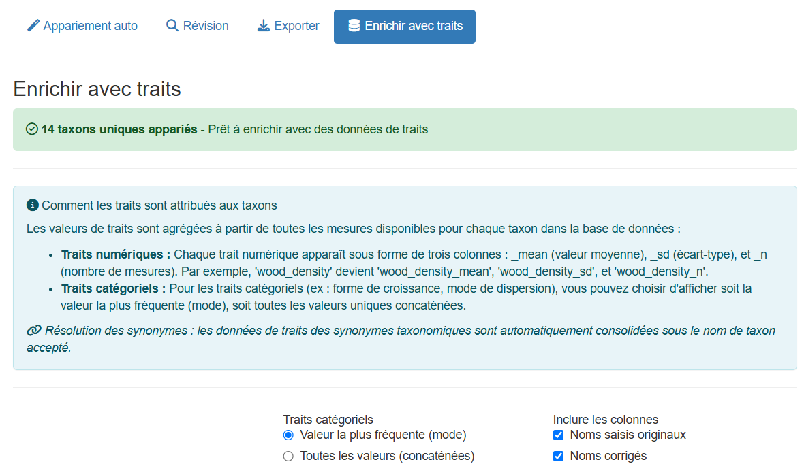

Un taxon porte généralement plusieurs mesures d'un même trait, issues d'individus, de sources ou d'études différentes : chaque trait doit donc être résumé à une seule valeur par taxon avant de devenir une colonne. La manière de le faire dépend du type de trait :

- **Traits numériques** (densité du bois, masse des graines, …) : restitués sous forme de trois colonnes — la **moyenne**, l'**écart-type** et **n**, le nombre de mesures qui la sous-tendent. Lisez toujours `n` avant d'utiliser une moyenne : une densité du bois moyennée sur une seule mesure et une autre moyennée sur quarante donnent le même nombre avec un poids très différent derrière, et un écart-type n'a de sens qu'à partir de quelques mesures
- **Traits catégoriels** (forme de croissance, phénologie, …) : résumés selon le mode d'agrégation que vous choisissez

**Options :**

- **Mode d'agrégation catégorielle** :
  - "mode" — Utiliser la valeur la plus fréquente par taxon. Donne une valeur unique et nette par taxon, mais masque silencieusement les désaccords entre sources
  - "concat" — Concaténer toutes les valeurs uniques. Conserve chaque valeur enregistrée : la variation réelle comme les contradictions restent visibles. À privilégier lorsque vous comptez examiner les traits plutôt que calculer directement dessus

- **Sélectionner les colonnes à inclure** :
  - Noms saisis originaux
  - Noms standardisés (`corrected_name`, `matched_name`)
  - Identifiants des taxons (`idtax_n`, `idtax_good_n`)
  - Détails de l'appariement (méthode, score, synonymie)

Les traits disponibles incluent la forme de croissance, la densité du bois, les traits foliaires et les caractéristiques écologiques. Les traits effectivement renvoyés dépendent de ce que la base contient pour *vos* taxons : une liste d'essences de bois d'œuvre bien étudiées sera donc bien mieux couverte qu'une liste d'herbacées.

Les données enrichies combinent vos taxons appariés avec les traits sélectionnés. Deux vues sont disponibles sous forme de sous-onglets : un **format large** (une ligne par taxon, traits en colonnes) et un **format long** (une ligne par combinaison taxon × trait) :

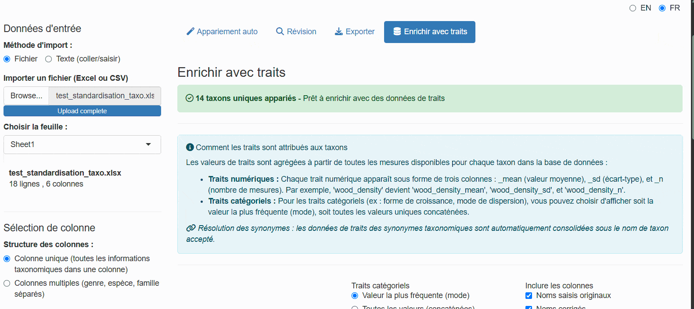

**Note** : L'export enrichi crée une ligne par taxon unique, pas par ligne d'entrée. Les noms d'entrée sont concaténés avec des séparateurs pipe.

#### Panneau Sources des Données

Un sous-onglet **Sources des données** liste toutes les citations de traits utilisées, avec le nombre de mesures par source. Cela vous aide à suivre la provenance des données pour votre analyse et à citer les sources correctement.

#### Télécharger les données enrichies

Inutile de revenir à l'onglet Exporter : chaque sous-onglet de résultats porte son propre bouton de téléchargement vert.

- **Télécharger format large** — une ligne par taxon, traits en colonnes
- **Télécharger format long** — une ligne par taxon × trait, affiché uniquement lorsque des données au format long existent

Les deux produisent un **fichier Excel** nommé `taxa_traits_wide_AAAAMMJJ.xlsx` ou `taxa_traits_long_AAAAMMJJ.xlsx`, daté du jour du téléchargement. Chaque fichier contient une feuille `traits` et, dès lors que des citations ont été collectées, une seconde feuille `citations` reprenant la provenance du panneau Sources des données — les sources voyagent ainsi avec les données au lieu de rester dans l'application.

L'onglet Export et ces boutons répondent à deux questions différentes : l'Export vous rend vos lignes avec les noms standardisés, tandis que ceux-ci vous donnent le tableau de traits construit à partir d'eux, une ligne par taxon.

## Comprendre les Colonnes de Sortie

Vos colonnes d'origine sont toujours conservées. L'application ajoute les colonnes ci-dessous — les mêmes descriptions sont affichées dans l'application elle-même, à côté du tableau d'aperçu de l'onglet Exporter : vous n'avez donc pas à revenir ici pour les lire.

### Quel nom utiliser ? {#quel-nom-utiliser}

**Utilisez `corrected_name`.** C'est le nom valide (accepté) de chaque taxon, et la seule colonne de noms dont vous avez besoin pour vos analyses. Les autres colonnes de noms retracent le chemin suivi par l'application. Chaque nom passe par deux étapes — *votre nom saisi → `matched_name` → `corrected_name`* :

| Votre nom saisi | `matched_name` | `is_synonym` | `accepted_name` | `corrected_name` |
|-----------------|----------------|--------------|-----------------|------------------|
| Garcinea kola | Garcinia kola | `FALSE` | *(vide)* | **Garcinia kola** |
| Chlorophora excelsa | Chlorophora excelsa | `TRUE` | Milicia excelsa | **Milicia excelsa** |

1. **L'appariement** associe votre nom saisi à une entrée du référentiel taxonomique. Cette entrée est le **nom apparié**, `matched_name` : l'orthographe est corrigée, mais il peut s'agir d'un synonyme.
2. **La résolution des synonymes** remplace un synonyme par le nom accepté auquel il renvoie. Le résultat est `corrected_name`. Lorsque `matched_name` n'est pas un synonyme, les deux sont identiques.

Les autres colonnes de noms documentent cette seconde étape ; ce ne sont pas des alternatives à `corrected_name` : `is_synonym` indique si un remplacement a eu lieu, et `accepted_name` n'est renseigné **que** pour les synonymes (vide sinon — c'est pourquoi il ne peut pas servir de colonne de référence). Lorsqu'un référentiel autre que l'interne a été choisi, `backbone_taxon_name` est de même déjà reporté dans `corrected_name`.

L'application et ce guide emploient les mêmes mots pour cette chaîne : le **nom saisi** est le vôtre, le **nom apparié** est l'entrée du référentiel qui lui a été associée, et le **nom accepté** est le nom valide de ce taxon.

### Toutes les colonnes ajoutées

| Colonne | Description |
|---------|-------------|
| `corrected_name` | **Le nom à utiliser.** Identique à `matched_name`, sauf lorsque `matched_name` est un synonyme : il contient alors le nom accepté à la place (ou le nom du référentiel choisi, si un référentiel a été choisi) |
| `matched_name` | Nom du référentiel auquel votre nom saisi a été apparié, orthographe corrigée. Il peut s'agir d'un synonyme : utilisez `corrected_name` pour vos analyses |
| `idtax_n` | Identifiant de `matched_name` dans le référentiel taxonomique |
| `idtax_good_n` | Identifiant du taxon accepté dans le référentiel taxonomique. Diffère de `idtax_n` lorsque `matched_name` est un synonyme |
| `is_synonym` | `TRUE` lorsque `matched_name` est un synonyme ; `corrected_name` contient alors son nom accepté |
| `accepted_name` | Renseigné uniquement lorsque `matched_name` est un synonyme : le nom accepté auquel il renvoie, déjà reporté dans `corrected_name`. Vide sinon |
| `match_method` | Comment le nom a été apparié — voir le tableau ci-dessous |
| `match_score` | Similarité entre votre nom saisi et `matched_name`, de 0 à 1 (1 = exact, ou appariement que vous avez confirmé vous-même) |

Lorsqu'un référentiel autre que l'interne est choisi (voir [Noms issus d'un autre référentiel](#noms-issus-dun-autre-référentiel)), les colonnes ci-dessous sont ajoutées et `corrected_name` est **remplacé** par le nom de ce référentiel partout où il en existe un :

| Colonne | Description |
|---------|-------------|
| `backbone_taxon_name` | Nom accepté dans le référentiel choisi, déjà reporté dans `corrected_name` |
| `backbone_family` | Famille selon le référentiel choisi |
| `backbone_authors` | Autorité taxonomique selon le référentiel choisi |
| `backbone_status_raw` | Statut du nom dans le référentiel choisi (ex. `Accepted`) |
| `name_source` | Référentiel ayant fourni `corrected_name` : `internal`, ou le code du référentiel choisi (`wcvp`, `apd`, ...) |

Le choix de WCVP répète en outre ces quatre colonnes sous les noms `wcvp_taxon_name`, `wcvp_family`, `wcvp_taxon_authors` et `wcvp_taxon_status`, ceux qu'elles portaient avant l'existence de tout autre référentiel, afin que les scripts écrits pour les versions antérieures les retrouvent.

### Valeurs de `match_method`

| Valeur | Signification |
|--------|---------------|
| `exact` | Le nom a été trouvé tel quel dans le référentiel. Les quatre niveaux exacts renvoient tous `exact` — voir la note ci-dessous |
| `genus_constrained` | Le genre a été reconnu : l'appariement approximatif a donc été restreint aux espèces de ce genre. C'est généralement le résultat approximatif le plus fiable |
| `fuzzy` | Appariement approximatif sur l'ensemble du référentiel, utilisé lorsque le genre n'a pas été reconnu |
| `manual` | Vous avez choisi ce nom vous-même dans l'onglet Révision |
| `unresolved` | Vous avez marqué ce nom comme impossible à résoudre dans l'onglet Révision |
| `no_match` | L'appariement automatique n'a rien trouvé et le nom n'a pas encore été révisé |

**Le niveau exact n'est pas consigné dans `match_method`.** Les quatre niveaux exacts — espèce, genre, famille et rang supérieur — écrivent tous `exact`. Celui qui s'est appliqué est consigné séparément dans `tax_level` (`genus`, `family`, `order`, `higher`) : consultez donc cette colonne plutôt que d'attendre `exact_species` ou `exact_genus`, que l'application ne produit jamais.

L'application ajoute également un identifiant de ligne interne `id_data` lorsque votre fichier n'en contient pas déjà un. Il sert à garder les lignes alignées durant l'appariement et la révision, et il est retiré de tous les exports : vous ne le verrez donc pas dans le fichier téléchargé.

## Options Avancées

### Sélection de la Langue

L'application supporte **l'opération bilingue** avec des interfaces en français et en anglais. **Le français est la langue par défaut**.

Un sélecteur de langue est situé en haut à droite de l'application :
- Cliquez sur **"FR"** pour l'interface en français
- Cliquez sur **"EN"** pour l'interface en anglais

Le changement est instantané et affecte tous les éléments de l'interface. Pour définir la langue initiale par programme :

```{r, eval=FALSE}
# Lancer l'application en anglais
launch_taxonomic_match_app(language = "en")

# Lancer l'application en français (par défaut)
launch_taxonomic_match_app(language = "fr")
```

### Noms issus d'un autre référentiel

L'application peut optionnellement restituer les résultats dans les termes d'un référentiel externe plutôt que du référentiel interne — le **World Checklist of Vascular Plants (WCVP)**, maintenu par les Royal Botanic Gardens de Kew, l'**African Plant Database (APD)**, ou tout autre référentiel que la base de données taxa déclare comme source de noms. Un menu **"Noms dans les résultats"** apparaît dans la barre latérale, listant le référentiel interne et tous ceux qui sont disponibles ; il est absent lorsque la base n'en propose aucun, ainsi qu'en mode hors ligne, où aucun lien ne peut être suivi.

Ce choix ne modifie pas l'appariement lui-même — les noms sont toujours appariés d'abord au référentiel interne — mais il change ce que rapporte la sortie. Choisir un référentiel ajoute quatre colonnes :

- `backbone_taxon_name` — Nom accepté dans ce référentiel
- `backbone_family` — Famille selon ce référentiel
- `backbone_authors` — Autorité taxonomique selon ce référentiel
- `backbone_status_raw` — Statut du nom dans ce référentiel (ex. `Accepted`)

**Cela réécrit également `corrected_name`.** Partout où le référentiel choisi contient le taxon, `corrected_name` devient son nom plutôt que celui du référentiel interne ; les taxons qui en sont absents conservent leur nom interne. La colonne `name_source` enregistre quel référentiel a fourni chaque valeur (`internal`, ou le code du référentiel choisi), ce qui rend la substitution vérifiable — consultez-la avant de considérer que `corrected_name` provient d'un référentiel unique.

Choisissez un référentiel lorsque vos résultats doivent s'aligner sur une liste de référence internationale, et laissez le menu sur le référentiel interne lorsque vous avez besoin de noms cohérents avec le reste de la base. Le choix doit être fait **avant** l'appariement, la consultation s'effectuant au cours de cette étape.

#### Citer le référentiel choisi {#citer-le-referentiel}

WCVP et APD sont des ouvrages publiés : utiliser leurs noms, c'est les citer. Dès que vous en choisissez un, l'application affiche la citation demandée par son éditeur, juste sous le menu, accompagnée d'un lien vers la source :

- **APD** — African Plant Database, Conservatoire et Jardin botaniques de la Ville de Genève et South African National Biodiversity Institute, Pretoria — <http://africanplantdatabase.ch>
- **WCVP** — World Checklist of Vascular Plants, Royal Botanic Gardens de Kew — <http://sftp.kew.org/pub/data-repositories/WCVP/>. La formulation de Kew crédite également **rWCVP**, le package R avec lequel notre copie a été téléchargée

La version et la date d'accès figurant dans la phrase sont celles de la copie **présente dans la base**, et non du jour où vous lancez la requête. Deux personnes citant la même exécution citent donc la même chose, et une exécution de l'an dernier continue de citer ce qu'elle a réellement utilisé.

L'export Excel emporte la citation avec les données, sur une seconde feuille nommée `citations` — référence, éditeur, version, date d'accès, lien et la phrase elle-même. Un CSV ne contient qu'une seule table et ne peut pas la transporter ; copiez la phrase depuis l'application si vous exportez dans ce format.

Depuis la console, le même texte s'obtient avec `query_citations()`, aux côtés des citations de traits, ou avec `backbone_reference()` si vous voulez la version et la date dans des colonnes distinctes :

```r
cons <- list(main = call.mydb(), taxa = call.mydb.taxa())

# tout ce qu'il y a à citer, traits et sources de noms réunis
query_citations(cons$main)

# seulement les sources de noms, avec le détail
backbone_reference(con_taxa = cons$taxa)
backbone_reference("wcvp", cons$taxa)$citation
```

Dans `query_citations()`, les lignes de référentiel portent `source = "backbone"` et aucun `id_citation` — elles vivent dans la base taxa, pas dans `table_citations`, et aucune clé étrangère ne pointe vers elles. La phrase à coller se trouve dans `notes`.

### Ajuster l'appariement approximatif {#ajuster-la-correspondance-approximative}

La sensibilité de l'appariement se règle avec le champ **Similarité minimale (%)**, en haut de l'onglet Appariement auto, à côté du bouton Démarrer l'appariement. Sa valeur initiale est de **60 %**.

Des valeurs plus basses ratissent plus large mais peuvent inclure des faux positifs ; des valeurs plus élevées sont plus conservatrices mais laissent davantage de noms à réviser à la main. Le champ étant placé juste à côté du bouton, la bonne façon de s'en servir est d'exécuter, de lire les statistiques dans la barre latérale, d'ajuster puis de relancer sur la même liste — une décision prise au vu des noms que vous avez sous les yeux, plutôt que fixée à l'avance.

Le seuil réellement utilisé par chaque exécution est conservé avec elle : il figure dans le script généré sous **Afficher le code R équivalent**, de sorte qu'une exécution reste reproductible sans que vous ayez à noter la valeur.

Ce même seuil sert de valeur initiale au curseur **Similarité min. (%)** de l'onglet Révision, qui filtre les suggestions proposées. Déplacer l'un ne déplace pas l'autre : le curseur de révision sert à élargir ou restreindre ce qui vous est montré pour un nom donné.

### Augmenter les Suggestions

Lister plus de suggestions par nom dans l'onglet Révision (le curseur de similarité choisit lesquelles ; ce paramètre ne fait que limiter une longue liste, et 50 au plus sont récupérées) :

```{r}
# Lister jusqu'à 40 suggestions au lieu des 20 par défaut
launch_taxonomic_match_app(max_suggestions = 40)
```

Vous pouvez aussi ajuster ceci de manière interactive dans l'onglet Révision en utilisant le curseur.

### Mode Hors Ligne

Si vous n'avez pas de connexion à la base de données, cliquez sur **"Utiliser hors ligne (référentiel en cache)"** sur l'écran de connexion. L'application :

- Télécharge et met en cache le référentiel localement à la première utilisation
- Effectue la comparaison de chaînes entièrement dans R via `stringdist` (trigramme-Jaccard)
- Prend en charge l'appariement automatique, les suggestions approximatives et la recherche manuelle
- Masque l'onglet Enrichissement par les traits (nécessite une connexion active)
- Affiche un badge **"Lecture seule"** tout au long de la session

## Paramètres de la Fonction

```{r}
launch_taxonomic_match_app(
  data            = NULL,          # Optionnel : pré-charger un data.frame
  name_column     = NULL,          # Optionnel : pré-sélectionner une colonne
  language        = c("fr", "en"), # Langue de l'interface (par défaut : "fr")
  max_suggestions = 20,            # Suggestions listées au plus par nom en Révision
  mode            = "interactive", # Mode de révision ("interactive" ou "batch")
  launch.browser  = TRUE           # Ouvrir l'application dans le navigateur
)
```

## Dépannage

### Problèmes de Connexion

**Problème** : "Échec de connexion à la base de données"

**Solutions** :
```{r}
# Vérifier la connexion
db_diagnostic()

# Réinitialiser les identifiants si nécessaire
remove_db_credentials()
setup_db_credentials()
```

Alternativement, utilisez le **mode hors ligne** (cliquez sur "Utiliser hors ligne (référentiel en cache)" sur l'écran de connexion) pour travailler sans connexion active à la base de données.

### Aucune suggestion approximative trouvée

**Problème** : Aucune suggestion n'apparaît pour les noms non appariés

**Causes possibles** :
- Le champ **Similarité minimale (%)** de l'onglet Appariement auto est réglé trop haut
- Les noms taxonomiques contiennent des fautes de frappe ou un formatage non standard
- Les noms ne sont pas présents dans le référentiel taxonomique (ex. taxons non africains)

**Solutions** :
- Diminuer **Similarité minimale (%)** dans l'onglet Appariement auto et relancer, ou élargir le curseur **Similarité min. (%)** de l'onglet Révision
- Utiliser le filtre de niveau taxonomique pour chercher au niveau du genre ou de la famille
- Nettoyer les noms en entrée (supprimer les espaces supplémentaires, corriger les fautes évidentes)
- Vérifier que les noms sont des taxons africains

### Appariement lent {#performance-de-correspondance-lente}

**Problème** : L'appariement prend très longtemps pour les grands jeux de données

**Solutions** :
- **Lancer l'application en local plutôt que d'utiliser la copie hébergée.** L'application hébergée à l'adresse <https://cafri-taxomatch.lab.sspcloud.fr> est souvent nettement plus lente que la même application sur votre propre ordinateur portable, et non parce que le serveur serait petit. Il est partagé. Chaque appariement lancé là-bas se dispute le même quota de CPU que celles de tous les autres utilisateurs, et ce quota relève de la capacité de pointe plutôt que d'une réservation : sur un nœud SSP Cloud chargé, vous pouvez en obtenir moins que ce que le plafond laisse espérer. À cela s'ajoutent le téléversement de votre fichier avant tout traitement et un aller-retour réseau à chaque clic. En local, la machine est à vous seul. La copie hébergée existe pour la commodité et pour les personnes qui n'utilisent pas R — pour une longue liste que vous traitez vous-même, lancez-la depuis R.
- Activer le **mode hors ligne** : l'appariement s'exécute localement via `stringdist`, sans allers-retours vers la base de données
- Utiliser le traitement par lots à la place : `match_taxonomic_names()` pour un flux de travail programmatique
- Traiter les données en morceaux (diviser les grands jeux de données)

## Quand Utiliser l'Application vs. l'Approche Programmatique

### Utilisez l'Application Shiny quand :

- Exploration interactive des données
- Vous préférez les interfaces visuelles
- Le jeu de données est de petite à moyenne taille (<5 000 lignes)
- Besoin de réviser manuellement les appariements incertains
- Apprentissage du processus d'appariement

### Utilisez `match_taxonomic_names()` quand :

- Traitement de grands jeux de données (>5 000 lignes)
- Automatisation des flux de travail dans des scripts
- Intégration avec des pipelines de données
- La reproductibilité est critique (*NE JAMAIS SUPPRIMER LA COLONNE CONTENANT LE NOM ORIGINAL*)
- Traitement par lots de plusieurs fichiers

Exemple d'approche programmatique :

```{r}
# Charger les données
my_data <- read.csv("inventaire_arbres.csv")

# Apparier les noms
matched <- match_taxonomic_names(
  names = my_data$nom_espece,
  min_similarity = 0.7
)

# Fusionner avec les données originales
result <- cbind(my_data, matched)

# Exporter
write.csv(result, "inventaire_standardise.csv", row.names = FALSE)
```

## Voir Aussi

- `match_taxonomic_names()` : Fonction d'appariement sous-jacente pour usage programmatique
- `query_taxa()` : Interroger directement le référentiel taxonomique
- `match_tax()` : Fonction simple de recherche taxonomique
- `launch_taxo_backbone_app()` : Outil interactif pour explorer le référentiel taxonomique
- `vignette("using-query-plots-fr")` : Guide pour interroger les données de parcelles

## Conseils pour de Meilleurs Résultats

1. **Nettoyez d'abord vos données** : Supprimez les fautes de frappe évidentes, les espaces supplémentaires et les caractères spéciaux
2. **Comprenez vos données** : Sachez quels groupes taxonomiques sont dans votre jeu de données
3. **Utilisez le mode multi-colonnes** : Si vous avez des colonnes séparées genre/espèce/famille, combinez-les pour une meilleur appariement
4. **Filtrez par niveau taxonomique** : Utilisez le filtre de niveau dans l'onglet Révision pour trouver des noms au rang du genre ou de la famille
5. **Examinez les scores d'appariement** : N'acceptez pas aveuglément les appariements à faible similarité (< 60 %)
6. **Utilisez le point de reprise** : L'application sauvegarde automatiquement votre progression — si vous fermez l'onglet, vous pouvez reprendre là où vous vous étiez arrêté
7. **Gardez l'exécution reproductible** : le seuil utilisé par une exécution est inscrit dans le script sous **Afficher le code R équivalent** — copiez-le plutôt que de noter la valeur à la main
8. **Citez les sources des données** : Consultez le panneau Sources des données dans l'onglet Traits pour les citations à inclure dans vos méthodes et, si vous avez choisi un référentiel autre que l'interne, citez-le également — voir [Citer le référentiel choisi](#citer-le-referentiel)

## Exemple de Flux de Travail

Voici un flux de travail complet du début à la fin :

```{r}
# 1. Charger vos données
trees <- read.csv("inventaire_forestier.csv")
# Colonnes : plot_id, tree_number, species_name, dbh, height

# 2. Lancer l'application avec les données
launch_taxonomic_match_app(
  data = trees,
  name_column = "species_name",
  language = "fr"
)

# 3. Dans l'application :
#    - S'authentifier (ou choisir le mode hors ligne)
#    - Revoir les appariements automatiques dans l'onglet Appariement auto
#    - Utiliser l'onglet Révision pour résoudre les noms non appariés
#    - Choisir optionnellement un autre référentiel pour les noms en sortie
#    - Enrichir optionnellement avec des traits dans l'onglet Enrichir avec les traits
#      (consulter le panneau Sources des données pour les citations)
#    - Exporter comme "inventaire_forestier_standardise.xlsx"

# 4. Continuer l'analyse avec les données standardisées
standardized <- readxl::read_excel("inventaire_forestier_standardise.xlsx")

# Vous avez maintenant des IDs taxonomiques propres pour des analyses ultérieures !
```

Ce flux de travail assure que vos données taxonomiques sont standardisées et prêtes pour des analyses en aval comme les métriques de diversité, les analyses basées sur les traits ou l'intégration dans la base de données.
